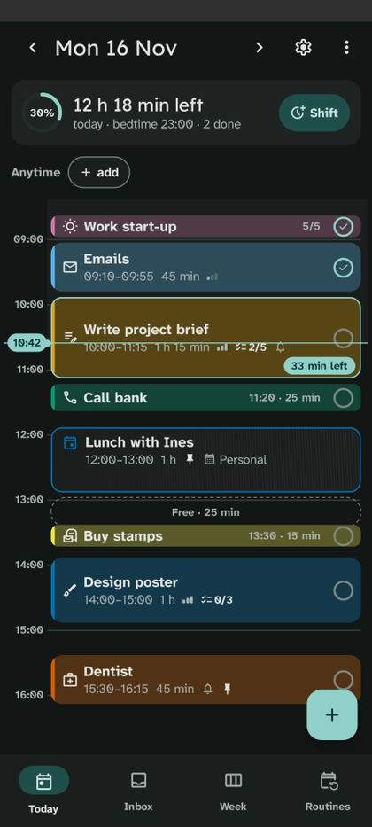
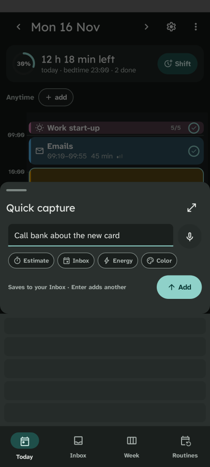
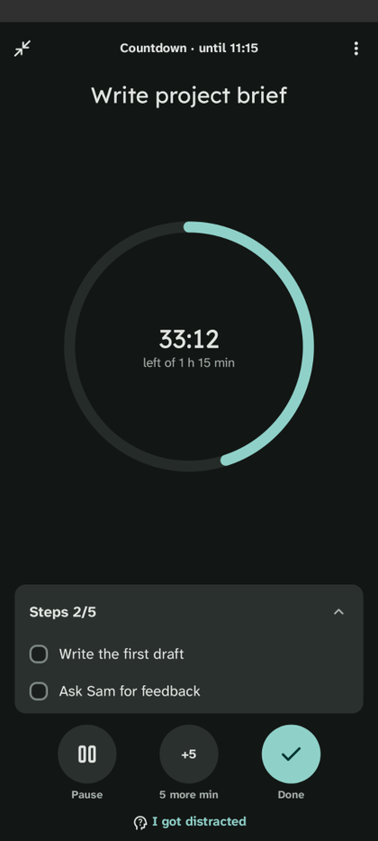
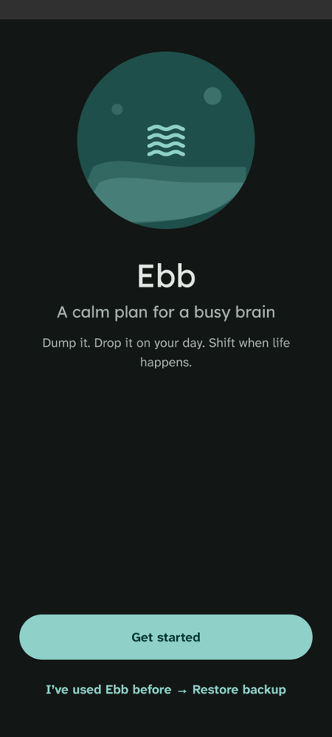
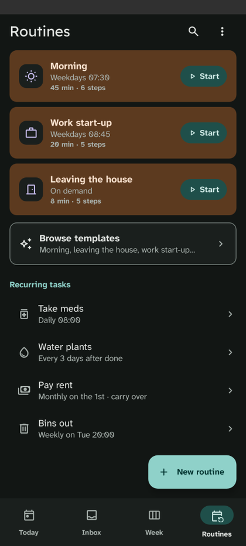
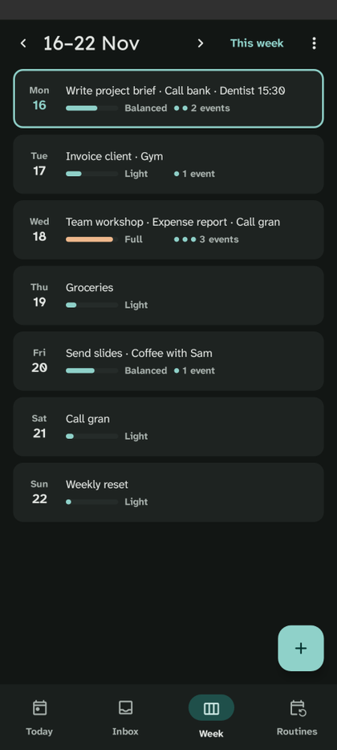
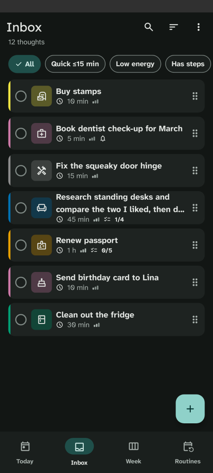
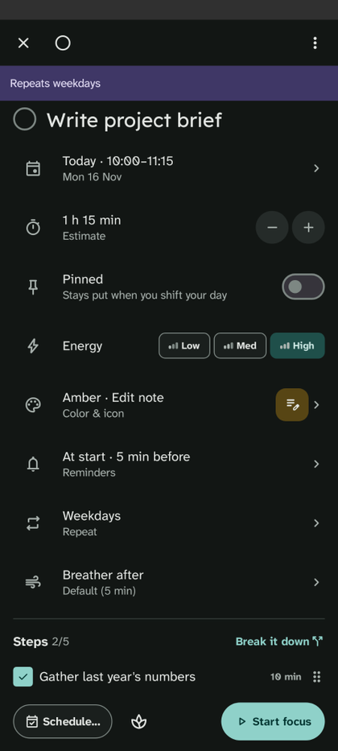
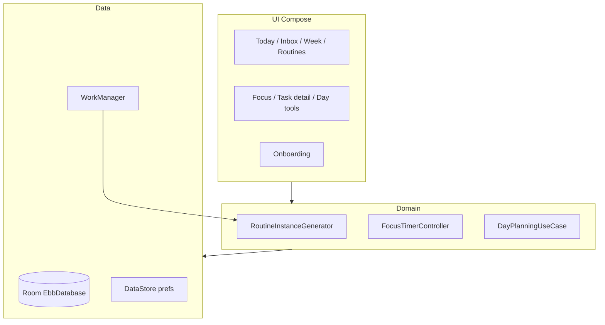

<p align="center">
  
</p>

<h1 align="center">Ebb</h1>

<p align="center">
  <strong>An ADHD-friendly day planner for Android — gentle scheduling, visual time, and forgiving workflows.</strong>
</p>

<p align="center">
  <a href="LICENSE"></a>
  <a href="https://kotlinlang.org"></a>
  
  
  <a href="https://github.com/CH4R4F/EBB/actions/workflows/android.yml"></a>
</p>

---

Ebb helps you see the day at a glance, capture tasks quickly, run focused work sessions, and repeat healthy habits without shame-based UX. The app uses **Material 3** and optional **Material You** dynamic color, with typography and spacing tuned for clarity and calm.

> **Note:** The application ID `app.ebbplanner` is a **placeholder** until store and trademark checks are complete (`gradle.properties` → `ebb.applicationId`).

## Screenshots

Paparazzi snapshot tests (dark theme) — not marketing mockups.

| | |
|:---:|:---:|
|  |  |
| **Today** — timeline, energy, scheduled blocks | **Quick capture** — NL parsing hint |
|  |  |
| **Focus** — timer with ring | **Onboarding** — welcome |
|  |  |
| **Routines** | **Week** |
|  |  |
| **Inbox** | **Task detail** — linked routine |

## Features (implemented)

- **Onboarding** — welcome, promise, day boundaries (wake/bed), preferences, interactive try-it, notification and exact-alarm education, calendar intro
- **Today** — scrollable timeline, scheduled / anytime tasks, calendar-event blocks, gaps, ring progress, multiselect, quick capture sheet with draft restore
- **Inbox & Week** — triage inbox; week grid with drag-style flows in UI tests
- **Routines (Repeat)** — daily / weekdays / weekly rules, rolling instance generation, skip rows, link inbox task to new routine, deferred sync when DB repair is pending
- **Task detail** — title, notes, subtasks, estimates, color/icon, reminders, schedule placement, routine detach
- **Focus** — per-task sessions: block end, fixed minutes, count-up, Pomodoro-style intervals; ring or bar; alarms when app is closed
- **Day tools** — shift the rest of the day, plan my day, overlap helper, make it fit (wired in navigation)
- **Reminders** — `AlarmManager` scheduling, boot reschedule, notification actions
- **Settings** — Material You toggle, default reminders, wake/bed display

Roadmap items (not yet shipping) are listed below.

## Getting started

### Requirements

- **JDK 17** (Temurin recommended — same as CI)
- **Android Studio** Ladybug or newer with **Android SDK 35** and Build Tools **35.0.0**
- `local.properties` with `sdk.dir=…` (or `ANDROID_HOME` / `ANDROID_SDK_ROOT`)

### Build

```bash
./gradlew assembleDebug
```

APK output: `app/build/outputs/apk/debug/app-debug.apk`

### Install a CI build

Each push to `main` runs [Android CI](.github/workflows/android.yml) and uploads a debug APK to the [**debug-latest** prerelease](https://github.com/CH4R4F/EBB/releases/tag/debug-latest).

```bash
# Example: download with GitHub CLI
gh release download debug-latest -p '*.apk'
adb install -r app-debug.apk
```

## Project structure

| Path | Purpose |
|------|---------|
| [`app/`](app/) | Android application module (`app.ebbplanner`) |
| [`app/src/main/java/app/ebbplanner/`](app/src/main/java/app/ebbplanner/) | UI, domain, data, DI, reminders |
| [`app/src/test/snapshots/`](app/src/test/snapshots/) | Paparazzi golden images |
| [`design/`](design/) | Design gallery, HTML/PNG exports, tokens |
| [`docs/`](docs/) | Product spec, architecture notes, README images |
| [`tools/`](tools/) | Token generation scripts |

Deeper architecture: [`docs/ARCHITECTURE.md`](docs/ARCHITECTURE.md). Product requirements: [`docs/ADHD_Day_Planner_Product_Spec.md`](docs/ADHD_Day_Planner_Product_Spec.md).

## Tech stack (summary)

| Layer | Technology |
|-------|------------|
| UI | Jetpack Compose, Material 3, Navigation Compose |
| DI | Hilt |
| Data | Room (SQLite), DataStore Preferences |
| Background | WorkManager (routine window generation) |
| Async | Kotlin coroutines, `Flow` |
| Testing | JUnit, Robolectric, Paparazzi, Turbine |



## Roadmap

- **Screens & flows** — Search, done history, garden/wins, remaining design coverage ([`design/COVERAGE.md`](design/COVERAGE.md))
- **Home screen** — Glance widgets, quick settings tile, shortcuts
- **Release** — Play listing, signing, privacy policy, production `applicationId`

## Contributing

We welcome issues and pull requests. See [CONTRIBUTING.md](CONTRIBUTING.md) and [CODE_OF_CONDUCT.md](CODE_OF_CONDUCT.md).

## License

Copyright © 2026 Charaf Marghin.

Licensed under the [Apache License, Version 2.0](LICENSE).