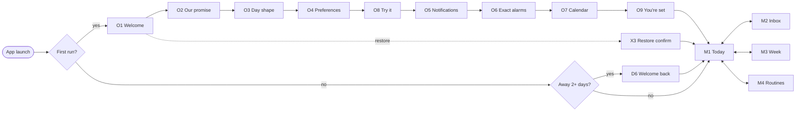
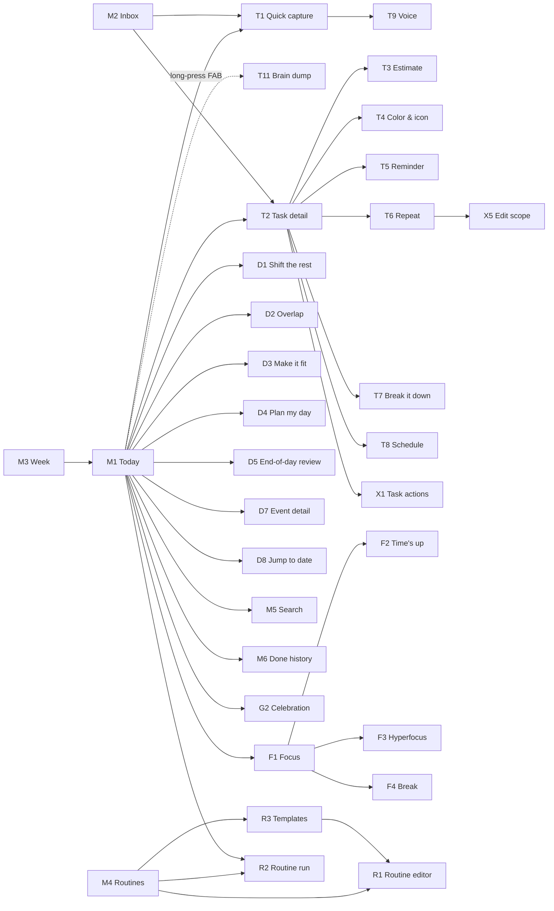
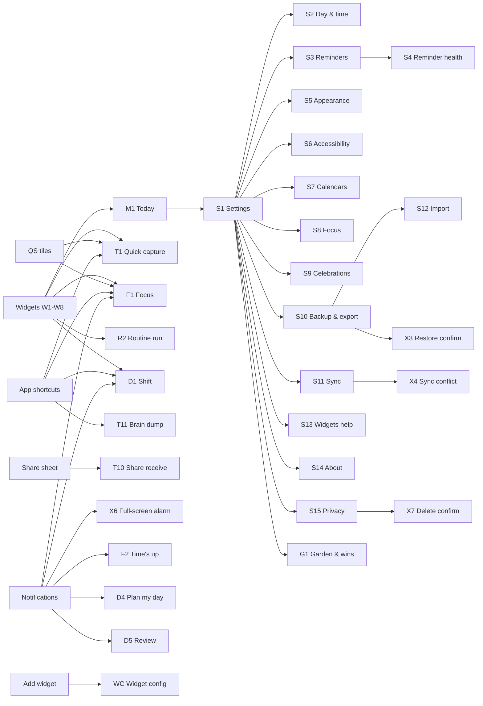

# Document control

| Field | Value |
|---|---|
| Product | Free, open-source, ADHD-friendly visual day planner for Android (Google Play + F-Droid) |
| Working name | **Ebb** (placeholder — see §6.2 for alternatives; needs trademark + Play Store name check) |
| Owner | Charaf Marghin |
| Document version | 1.0 — 16 Nov 2026 |
| Audience | Designer (primary), Android developers, open-source contributors |
| Status | Ready for design |

**How to read this document.** §1–§3 explain *what* and *why*. §4 is the complete screen inventory (the designer's checklist). §5 shows how people move through the app. §6 is the design system. §7 is technical constraints that affect design. §9 is the exact list of deliverables for the designer.

**About numbers in this document.** No statistics have been invented. Competitor prices come from the owner's research page (Todoist ~US$60/yr from late 2025; TickTick US$49.99/yr from Aug 2026). Everything else that looks like a number (durations, sizes, limits, defaults) is a **design default or assumption**, marked *(assumption)* where it is a guess rather than a platform rule. Android/Play platform rules cited in §7 must be re-verified at implementation time because Google changes them yearly.

**Priority labels used throughout.**

- **MVP** — must ship in the first public Play release (v1.0).
- **v1.x** — next 2–4 releases after launch.
- **Later** — valuable but not committed; design lightly or not at all.

---

# 1. Product vision

## 1.1 One-line vision

> A calm, visual day planner that helps people with ADHD (and anyone who struggles with time) turn a messy head into a doable day — free forever, open source, private, and kind.

## 1.2 The core loop

1. **Dump it** — get every task out of your head into the **Inbox** in seconds (typing, voice, share-sheet, widget, quick-settings tile).
2. **Drop it** — drag tasks onto a **visual timeline** of today, each block sized by how long it will take.
3. **Do it** — the app shows what's **now** and what's **next**, how much time is left, and reminds you reliably.
4. **Shift it** — when something overruns (it will), one tap **shifts the rest of your day**; nothing turns red, nothing scolds you.
5. **Close it** — a 1-minute, guilt-free **end-of-day review** celebrates what got done and gently re-homes the rest.

## 1.3 Problem statement (from research)

- Leading planners put core features behind subscriptions: recurring tasks, calendar views and calendar import are paywalled in competitors such as Structured, TickTick and Todoist; prices have risen (Todoist ~US$60/yr late 2025; TickTick US$49.99/yr Aug 2026).
- Reliability failures hurt ADHD users the most: broken or stale home-screen widgets (reported for Microsoft To Do, Google Keep) and missed reminders (reported for TickTick, Tasks.org).
- r/ADHD users repeatedly ask for **calm, low-feature** planners rather than power-user productivity suites, and dislike red overdue counters and streak-loss guilt.
- Free/open-source alternatives (TimePlanner, Daytile) are small and mostly absent from Google Play.

## 1.4 Positioning

| | Ebb | Typical paid planner |
|---|---|---|
| Price | Free forever, no paywall, no "Pro" | Subscription for recurring tasks / calendar / widgets |
| Account | Not required | Usually required |
| Data | On device; optional user-controlled sync | Vendor cloud |
| Tracking / ads | None | Often analytics SDKs |
| Tone | Kind, no guilt, no red overdue | Overdue counters, streak pressure |
| Source | Open (GPL-3.0 suggested) | Closed |

## 1.5 Design principles (ADHD-friendly)

Each principle has a **rule** the designer can test a screen against.

| # | Principle | What it means | Testable rule for every screen |
|---|---|---|---|
| P1 | **Low cognitive load** | One clear thing per screen; progressive disclosure. | ≤ 1 primary action per screen; advanced options hidden behind "More options". No screen shows more than ~7 distinct interactive groups *(assumption, heuristic)*. |
| P2 | **No guilt, ever** | Missed ≠ failed. The app never shames. | No red for overdue/missed. No "overdue" counts. Words like "failed", "late", "overdue", "missed" are banned from UI copy (use "still open", "rolled over", "waiting"). |
| P3 | **Make time visible** (time-blindness support) | Time must be *seen*, not calculated. | Every scheduled item shows its duration as physical size; the current moment is always marked with a "now" line; "time left" is shown as both a number and a shrinking visual. |
| P4 | **Dopamine-friendly feedback** | Small, immediate, pleasant rewards for starting and finishing. | Completing anything triggers a micro-celebration within 100 ms *(assumption)*, which can be reduced/turned off. No loss-based mechanics (no streak breaking). |
| P5 | **Forgiving rescheduling** | Plans are drafts. Changing them is one tap and undoable. | Every destructive or bulk change has Undo (snackbar ≥ 8 s, *assumption*). "Shift the rest of my day" reachable in ≤ 2 taps from Today. |
| P6 | **Minimal decisions** | Smart defaults; never force a choice to save a task. | A task can be saved with only a title. Every optional field has a default. Pickers offer 3–5 presets before "custom". |
| P7 | **Capture is instant** | The idea disappears in seconds if capture is slow. | Quick capture reachable in 1 tap from widget, tile, notification, and app; keyboard opens immediately. |
| P8 | **Reliable or honest** | Reminders must fire; if the OS might block them, say so plainly and help fix it. | The app checks its own reminder health and shows a calm, fixable status — never silently fails. |
| P9 | **Calm by default, stimulating by choice** | Low-saturation, quiet UI; users can opt into more color, sound and confetti. | Default theme uses muted palette; animations ≤ 300 ms; sounds off by default except reminders. |
| P10 | **Private and offline** | Works fully without internet or account. | No screen requires sign-in or network to function. |

## 1.6 Target personas

> Personas are illustrative composites built from the research themes, not from survey data.

### Persona A — "Maya, the time-blind creative" (ADHD, combined type)
- 27, freelance illustrator, works from home, irregular schedule.
- **Pain:** Loses hours to hyperfocus; forgets appointments; overwhelm when seeing a long list.
- **Needs:** Visual timeline, hyperfocus check-ins, gentle reminders, "what's now / what's next" widget.
- **Quote:** "If I can't see it, it doesn't exist."

### Persona B — "Daniel, the overwhelmed student" (ADHD, inattentive, recently diagnosed)
- 20, university student, uses free apps only.
- **Pain:** Starts many planners, abandons them after a bad week; shame spiral when the app shows 40 overdue tasks.
- **Needs:** "Welcome back" recovery without guilt, free recurring tasks for classes, calendar import from university calendar.
- **Quote:** "Every app punishes me for being away."

### Persona C — "Fatima, the parent juggling everything" (suspected ADHD, undiagnosed)
- 38, part-time nurse, two kids, shift work.
- **Pain:** Plans fall apart by 10 am; constant interruptions; mental load.
- **Needs:** One-tap "shift the rest of my day", routines (morning/school run), reliable alarms on a phone with aggressive battery saving, quick voice capture while hands are busy.
- **Quote:** "I don't need a system. I need to know what to do next."

### Persona D — "Sam, the privacy-minded developer" (ADHD, hyperactive)
- 33, software engineer, uses GrapheneOS-style setups and F-Droid.
- **Pain:** Refuses apps with trackers or mandatory accounts; wants data portability.
- **Needs:** Local-first, open source, export (JSON/ICS/CSV), file-based or self-hosted sync (WebDAV/Syncthing folder), focus timer.
- **Quote:** "My task list is nobody's business."

### Persona E — "Linh, the autistic + ADHD professional" (AuDHD)
- 30, data analyst, office job.
- **Pain:** Transitions between tasks are painful; sensory overload from busy UIs and loud sounds.
- **Needs:** Transition buffers, "heads-up" warnings before switches, reduced motion, no sounds, high predictability, consistent layout.
- **Quote:** "Warn me before the switch, not at the switch."

### Persona F — "Robert, the non-ADHD planner switcher" (no ADHD)
- 52, small business owner, left a paid planner after the price increase.
- **Pain:** Doesn't want to pay a subscription for recurring tasks and calendar view.
- **Needs:** Clean day + week view, calendar overlay, recurring tasks, widgets, backup.
- **Quote:** "I just want the basics to be free and to work."

### Persona G — "Aisha, low vision / accessibility user" (no ADHD, uses TalkBack + large font)
- 45, teacher with low vision.
- **Pain:** Drag-and-drop apps are unusable with a screen reader.
- **Needs:** Every drag action has a non-drag alternative; works at 200% font scale; high-contrast theme.

## 1.7 Non-goals (what Ebb will NOT be)

- **Not a project manager.** No Gantt charts, dependencies, kanban boards, multi-level projects, or team assignment.
- **Not a team/collaboration tool.** No shared lists, comments or assignees (maybe "Later": share a read-only day).
- **Not a habit tracker with streaks.** Routines exist, but there are no streak counters that can be "broken".
- **Not a calendar replacement.** Ebb *reads* device calendars; two-way calendar editing is "Later" at best.
- **Not a note-taking app.** Task notes are short plain text with links, no rich documents.
- **Not a medical/therapy tool.** No diagnosis, symptom tracking, or medication management claims. (Medication *reminders* can be created as ordinary recurring tasks, but the app makes no medical claims.)
- **No AI requirement.** No mandatory cloud AI. Any smart features (e.g., auto-split a task) must be optional and on-device, or clearly opt-in — "Later".
- **No monetization mechanics.** No ads, no paywall, no in-app purchases. Optional donation link only.
- **No account system run by the project.**


---

# 2. Feature specification

## 2.0 Core concepts and vocabulary

| Term | Definition |
|---|---|
| **Task** | Anything to do. Has a title; everything else optional. |
| **Inbox** | Unscheduled tasks ("brain dump"). Never shows an overdue state. |
| **Timeline** | Vertical, time-proportional view of one day. |
| **Block** | A task placed on the timeline with a start time and duration. |
| **Anytime task** | A task assigned to a day but not a time ("Today, sometime"). Shown in a tray above the timeline. |
| **Estimate** | How long a task is expected to take (default 15 min, *assumption*). |
| **Buffer / transition** | Optional gap automatically placed between blocks. |
| **Event** | A read-only item imported from a device calendar. |
| **Routine** | A reusable, ordered set of steps (e.g., "Morning") that can repeat. |
| **Energy** | Low / Medium / High tag on a task, and the user's current energy. |
| **Roll over** | Moving unfinished items to another day (never called "overdue"). |
| **Pebble** | Working name for the gentle reward token (see §2.13). |

## 2.1 Inbox / brain dump

### F-INB-01 Quick capture — **MVP**
- **Description:** Add a task in one step from anywhere.
- **Entry points:** FAB on Today and Inbox; Quick Capture widget; Quick Settings tile; persistent "Capture" action on the daily notification (optional); app-icon long-press shortcut; share sheet.
- **Behavior:**
  - Opens a bottom sheet (T1) with keyboard already open, cursor in title.
  - Pressing Enter/“Add” saves and **keeps the sheet open** for the next item (rapid dump); a counter chip shows "3 added" (neutral, not a goal).
  - Optional chips under the field: *Estimate*, *When*, *Energy*, *Color*. Untouched chips use defaults.
  - **Natural-language hints (v1.x):** "call mom 15m tomorrow 6pm" → title "call mom", estimate 15 min, scheduled tomorrow 18:00. Parsed parts are highlighted inline and can be tapped to undo the parse. On-device parser only.
  - Default destination: Inbox. If opened from Today with a time slot tapped, default destination = that slot.
- **Edge cases:**
  - Empty title + Add → nothing happens; no error message (field gently shakes only if reduced-motion is off).
  - Very long text (> 200 chars, *assumption*) → first line becomes title, the rest becomes notes.
  - Pasting multi-line text → offer "Add as 6 separate tasks?" (Yes / Keep as one).
  - Sheet dismissed accidentally with unsaved text → text is kept as a draft and restored next time (no "discard?" dialog).
  - Device locked (from tile/widget) → capture works on top of the lock screen only if user enabled "Capture from lock screen"; otherwise requires unlock.

### F-INB-02 Brain dump mode — **MVP**
- **Description:** A full-screen, distraction-free page for dumping many thoughts at once.
- **Behavior:** One task per line; a "Done dumping" button converts every non-empty line into an Inbox task. Optional gentle prompt rotating in the placeholder ("What's on your mind?", "Anything you're avoiding?", "Errands? Calls? Messages?").
- **Edge cases:** Lines starting with "- " or "• " are stripped; duplicate lines prompt "Merge duplicates?"; leaving the screen keeps the draft.

### F-INB-03 Voice capture — **MVP**
- **Description:** Speak a task.
- **Behavior:** Mic button in quick capture and on widget. Uses the Android system speech recognizer (RecognizerIntent / on-device where available) so the app doesn't need to record audio itself. Recognized text fills the title; user confirms or edits. "Keep talking" mode (v1.x) splits on pauses or on the word "next".
- **Edge cases:** No speech service installed (some de-Googled phones) → mic button hidden and a hint in Settings explains why. Recognition error → "Didn't catch that — try again or type it." Offline → use on-device recognizer if available, else explain.

### F-INB-04 Share-to-app — **MVP**
- **Description:** Share text, links, or images from any app into Ebb.
- **Behavior:** Appears in Android share sheet as "Add to Ebb". Opens a small sheet (T10) pre-filled: shared text → title (first line) + notes; URL → title = page title if provided by the sharing app, else URL; notes keep the link. Images (v1.x) are attached as a thumbnail reference.
- **Edge cases:** Share of very long text → notes; share of multiple items → "Add 4 tasks?".

### F-INB-05 Inbox list — **MVP**
- **Behavior:** Shows unscheduled tasks, newest first by default; sorts: Newest, Oldest, Shortest first, Energy. Swipe right = "Schedule today (anytime)"; swipe left = "Later…" menu (Tomorrow, This weekend, Next week, Someday). Long-press = multi-select. Drag handle on each card to drag directly onto Today (when Inbox is shown as a side drawer on tablets/foldables or the split "Plan" view).
- **No guilt:** Inbox items never age visually or turn red. Old items (> 30 days, *assumption*) are quietly offered in "Tidy up the inbox?" once a month, with options Keep / Someday / Archive.
- **Edge cases:** Empty inbox → calm empty state ("Your head is clear. Nice."). Hundreds of items → virtualized list; "Someday" section collapsed by default.

### F-INB-06 Someday shelf — **v1.x**
- A collapsible section for "not now, but don't forget". Excluded from all counts and widgets.

## 2.2 Timeline / day view (Today)

### F-DAY-01 Visual timeline — **MVP**
- **Description:** Vertical scrollable timeline of one day, hours on the left, blocks sized proportionally to duration.
- **Behavior:**
  - Default visible range = user's wake → sleep time (set in onboarding), with collapsible "early" and "late" zones.
  - Zoom: pinch to change hour height (3 levels: compact / comfortable / spacious). Default comfortable (*assumption*: ~72 dp per hour).
  - **Now line**: a horizontal line with a dot and current time label; auto-scrolls into view on open; past area is subtly dimmed (not grey-out-shamed — simply lower contrast).
  - Blocks show: color strip + icon, title, time range, duration, energy glyph, subtask progress (e.g., "2/5"), reminder bell if set. Short blocks (< 20 min) use a compact single-line layout.
  - **Anytime tray** above the timeline: tasks for today without a time, horizontally scrollable chips; drag down onto the timeline to schedule.
  - **Calendar events** (imported) render as outlined, hatched or lighter blocks with a calendar icon; they're read-only and can't be dragged.
  - **Free-time gaps** show a subtle "Free · 45 min" label; tapping a gap opens quick capture pre-set to that slot.
  - **Day header:** date, "x h y min left today" (P3), a compact progress ring of planned time completed, and buttons: *Shift*, *Plan my day*, overflow (⋯).
- **Edge cases:**
  - Overlapping blocks → shown side-by-side (max 2 columns, third+ collapses into a "+1" stack), plus a gentle "These overlap" hint chip that opens D2.
  - Blocks crossing midnight → split visual with "continues tomorrow" label.
  - Day exceeds available time (planned > remaining) → calm "This day is fuller than the time left" banner with "Make it fit" (opens D3). Never red.
  - Time zone change while traveling → times stay in local "wall clock" time by default; banner "You're in a new time zone" with option to keep or shift.
  - DST transitions → the repeated/skipped hour is shown accurately (skipped hour collapses, repeated hour doubled with labels).
  - All-day calendar events → shown as chips in the Anytime tray area with calendar icon.

### F-DAY-02 Drag-to-schedule — **MVP**
- **Behavior:**
  - Long-press (≈ 300 ms, system default) on any Inbox/Anytime task or block lifts it (elevation + haptic). Drag to a time; a ghost preview shows the start and end time snapped to 5-min increments (configurable 5/10/15).
  - Dragging near top/bottom edge auto-scrolls.
  - Dropping onto another block → offers "Push later items down" (default, animated) or "Overlap".
  - Bottom edge of a block has a resize handle to change duration; a tooltip shows the new duration.
  - From Inbox to Today: on phones, the "Plan" split view (Plan my day, D4) shows Inbox list at bottom half and timeline at top half for drag. Also on the Inbox tab: long-press + drag to the "Today" tab icon jumps to Today in drag mode.
  - **Accessible alternative (MVP, mandatory):** every card has "Schedule…" in its menu → time picker sheet (T8) with presets ("Next free slot", "After current task", "This afternoon", "Pick time"). TalkBack custom actions: "Move 15 minutes earlier/later", "Make longer/shorter", "Schedule in next free slot".
- **Edge cases:** Drop into the past → allowed (log what you did) with subtle confirmation "Logged at 9:00"; drop onto event → overlap with event allowed but hint shown; drag cancelled (finger outside) → returns with animation; undo always available.

### F-DAY-03 Time estimates & visual time remaining — **MVP**
- **Estimate picker** (T3): presets 5, 10, 15, 30, 45 min, 1 h, 1.5 h, 2 h, custom. Default 15 min (*assumption*).
- **"Estimate honesty" helper (v1.x, opt-in):** after completion the app optionally records actual time (from timer or start/finish taps) and shows a private, kind insight: "Emails usually take you about 25 min — want to use that?" No scores.
- **Time remaining visuals:**
  - Current block shows a **draining fill** (the block's background empties left-to-right or top-to-bottom as time passes) plus "12 min left".
  - Day header: "4 h 10 min left until your bedtime (23:00)".
  - Widget and notification show the same.
- **Edge cases:** Task with no estimate on timeline → uses default and labels "~15 min". Tasks over 4 h (*assumption*) → prompt "Big one! Break it into steps?" (opens subtask breakdown).

### F-DAY-04 Shift the rest of my day — **MVP (signature feature)**
- **Description:** One tap moves all upcoming, not-done, movable blocks later (or earlier) to absorb an overrun.
- **Entry points:** "Shift" button in Today header; the current block's menu ("I need more time"); actionable notification when a block ends but isn't marked done ("+15 min" / "Shift the rest"); Now & Next widget button.
- **Behavior:**
  - Opens D1 **preview sheet**: presets +5, +15, +30, +60 min, "Start from now" (aligns next block to now), custom. Shows a mini before/after timeline.
  - Rules: only shifts blocks after "now" that are not done, not pinned, and not calendar events. **Pinned** blocks (e.g., doctor appointment) stay put; tasks flow around them (fill gaps before/after the pin, preserving order).
  - Buffers between blocks are preserved.
  - Items pushed past bedtime are listed: "2 tasks won't fit today" → options: *Move to tomorrow*, *Move to Inbox*, *Keep anyway (stay up)*.
  - Apply → animated slide; snackbar "Day shifted 15 min · Undo".
- **Edge cases:** Nothing to shift → "Nothing coming up to move. You're free!"; shift while a focus timer runs → timer's end extends too; recurring routine instances shift for this day only; shifting backwards (earlier) limited to not before now.

### F-DAY-05 Pinned vs flexible blocks — **MVP**
- Each block is *Flexible* (default) or *Pinned* (fixed time). Pinned shows a small pin glyph. Calendar events are always pinned.

### F-DAY-06 Mark done / partial / skip — **MVP**
- Tap the round check on a block → done (micro-celebration). Long press check → "Partly done" (keeps remaining as new block / back to inbox with note) or "Skip today" (for recurring). Done blocks shrink to their actual duration if timer was used (v1.x) and get a soft checked style (not struck through heavily).

### F-DAY-07 Date navigation — **MVP**
- Swipe left/right on the timeline header to change day; tap date for mini-calendar (D8); "Today" button returns. Future days show plans; past days show what happened (read-mostly, editable).

### F-DAY-08 Overlap / conflict helper — **MVP**
- D2 sheet lists overlapping items and offers: "Push later", "Shorten earlier", "Move one to next free slot", "Keep both".

### F-DAY-09 "Make it fit" (overfull day) — **v1.x**
- D3 sheet: shows total planned vs. available; suggestions in plain language: move lowest-energy-match tasks to tomorrow, shorten buffers, move "anytime" tasks to tomorrow. User checks which to apply. No auto-changes without preview.

## 2.3 Energy levels — **MVP (basic) / v1.x (matching)**
- **MVP:** Tasks can be tagged Low / Medium / High energy (glyph: 1/2/3 small bars or a battery-like icon, not color only). Inbox filter by energy.
- **v1.x — "How's your energy?" check-in:** optional 1-tap chip in Today header (😴 Low · 🙂 OK · ⚡ High — rendered with icons, emoji optional). When Low, Inbox and "next up" suggestions sort low-energy tasks first; Today shows "Low-energy mode: showing gentle options first".
- **v1.x — Energy curve:** user may set typical energy by time of day (morning/afternoon/evening); timeline background shows a very subtle energy band; "Next free slot" scheduling can prefer matching slots.
- **Edge cases:** Energy never set → feature invisible except the optional chip; no nagging.

## 2.4 Routines & recurring tasks — **MVP (all free)**

### F-RTN-01 Recurring tasks — **MVP**
- Repeat options (T6): None, Daily, Weekdays, Weekly (pick days), Every N days/weeks, Monthly (date or "2nd Tuesday"), Yearly, Custom (RRULE-compatible). "After completion" mode ("3 days after I last did it") for chores.
- Recurring items appear on the timeline at their time or in the Anytime tray.
- Editing a recurring item asks scope (X5): *This one*, *This and future*, *All*.
- **No guilt:** missed occurrences are not piled up. Default "Don't stack": only the next occurrence exists; skipped past ones quietly disappear into history. Option "Carry over if not done" for tasks that must happen (e.g., pay rent).
- **Edge cases:** Monthly on 31st → "last day of month" option; DST; time zone travel; deleting the series vs. one instance; changing recurrence of a series with history (history kept).

### F-RTN-02 Routines (step lists) — **MVP**
- A routine = name, icon, color, list of steps each with an optional estimate, total duration auto-summed, schedule (time + repeat) or "on demand".
- On the timeline a routine is one block ("Morning routine · 45 min · 0/6").
- **Routine Run (R2):** step-by-step player: big current step, timer per step (optional), "Done → next", "Skip step", progress dots; "Running behind" shows how far behind relative to the total, with calm option "Skip the rest" / "Shift my day".
- **Templates (R3):** Morning, Evening wind-down, Leaving the house checklist, Work start-up, Work shutdown, Weekly reset, Study session. Templates are editable copies, not prescriptions.
- **Edge cases:** Routine with 0 steps → can't be saved as routine, becomes a task; routine run interrupted (app killed) → resumes at same step; routine edited while running → applies next run.

## 2.5 Subtasks — **MVP**
- Checklist inside any task (one level only — no nesting, by design).
- Add via task detail, or "Break it down" (T7): a focused sheet prompting "What's the very first tiny step?" then "And after that?". Optional estimates per subtask; parent estimate = sum if parent has none.
- Block shows "2/5". Completing all subtasks offers "Mark task done?" (not automatic — the user may want to add more).
- Subtasks can be promoted to their own task ("Make this a separate task").
- **Later:** optional on-device "suggest steps" — opt-in only.

## 2.6 Focus / timer mode — **MVP**
- **Start from:** current block ("Start focus"), any task menu, Focus widget, Quick Settings tile, notification action.
- **Timer types:** *Countdown to block end* (default), *Fixed* (5/15/25/45/60 min or custom), *Count-up* (open-ended, for "just start" mode), *Intervals* (work/break cycles — Pomodoro-style, user sets lengths).
- **Focus screen (F1):** task title, very large visual timer (a draining ring or bar — user choice), digits optional ("Hide numbers" to reduce anxiety), subtasks checklist, buttons: Pause, +5 min, Done, "I got distracted" (logs nothing punitive; offers "Back to it" or "Switch task").
- **"Just 5 minutes" start (MVP):** a button that starts a 5-minute count, then asks "Keep going?" — beats task-paralysis.
- **Hyperfocus check-ins (MVP):** optional periodic nudge during long focus or when a block overruns: gentle sound/vibration + full-screen or heads-up card (F3): "You've been on *Design poster* for 90 minutes. Stretch, drink water? · Keep going 15 min · Wrap up · Shift my day". Interval configurable (30/45/60/90 min, *defaults are assumptions*).
- **Body-double / ambient sounds (Later):** optional bundled CC0 sounds (rain, café, brown noise) played locally.
- **Running in background:** ongoing notification with chronometer and actions (Pause, +5, Done). Timer end uses an exact alarm so it fires even if the app is killed (see §7).
- **Edge cases:** Phone reboot during timer → restore state, notify "Your timer was interrupted — continue?"; two timers → not allowed; starting a new one asks "Switch focus to X?"; Do Not Disturb active → respect system DND unless the user marked focus alerts as "alarm" category (explained in settings).
- **Optional DND integration (v1.x):** "Turn on Do Not Disturb while focusing" (requires notification policy access; asked only when toggled).

## 2.7 Transitions & buffers — **MVP (basic) / v1.x (smart)**
- **Buffers (MVP):** global default buffer between blocks (0/5/10/15 min; default 5 *assumption*). Shown as a soft striped gap labelled "Breather". Per-block override.
- **Heads-up before switch (MVP):** optional reminder X min before a block ends ("5 min left on *Emails* — next: *Call bank*"). Supports Persona E.
- **Travel/prep time (v1.x):** per-task "Get ready" time (e.g., 20 min before "Dentist") rendered as a lighter lead-in segment attached to the block, with its own reminder "Time to start getting ready for Dentist".
- **Transition prompt (v1.x):** when a block ends: small card "Wrap up *Emails*? → Next: *Call bank* (in 5 min)" with Done / +10 min / Shift.

## 2.8 Reminders & notifications — **MVP (reliability is a core feature)**

### F-NOT-01 Reminder types
| Type | Default | Behavior |
|---|---|---|
| Start reminder | On for scheduled blocks (at start time) | Heads-up notification: title, time, actions *Start focus*, *+10 min*, *Shift day*, *Done*. |
| Early heads-up | Off; choose 5/10/15/30/60 min before | Gentle, lower priority. |
| End / wrap-up | Off | "Time to wrap up" at block end. |
| Alarm-style (must not miss) | Off, per task | Full-screen intent on lock screen with sound + vibration until dismissed or snoozed. For medication, appointments, leaving the house. |
| Nag-until-acknowledged | Off, per task | Repeats gently every N min (5/10/15) up to M times until acknowledged. |
| Anytime nudge | Optional | "You have 3 things for today without a time — want to place one?" Once per day max; no counts shown on lock screen if "Private" mode is on. |
| Daily planning prompt | Optional (default suggested on in onboarding) | Morning: "Ready to plan your day? (2 min)". |
| Evening review prompt | Optional | "Want to close your day?" |

### F-NOT-02 Reliability
- Uses exact alarms (AlarmManager `setExactAndAllowWhileIdle` / `setAlarmClock` for alarm-style) when permission is granted; see §7.3 for permission rules.
- **Reminder health check (S4):** a screen + small status pill in Settings ("Reminders: all good ✓" / "Reminders may be delayed — fix") checking: notification permission, exact alarm permission, battery optimization exemption, channel not muted, DND access (if used), manufacturer-specific auto-start (links to dontkillmyapp-style guidance, opened in browser).
- Re-schedules all alarms on boot, app update, time change, and time-zone change.
- **Snooze:** 5 / 10 / 30 min / "Later today" / "Tomorrow"; snoozing never labels anything late.
- **Gentle wording** (see §6.12): "Time for: *Call bank*" not "Overdue: Call bank".
- **Edge cases:** Permission revoked → in-app calm banner on Today + falls back to inexact alarms with honest label "Reminders may be a few minutes late"; reminder for a task already done → cancelled; many reminders at the same minute → grouped ("3 things start now"); phone in DND → respects DND unless alarm-style.

### F-NOT-03 Notification channels (user-controllable in Android settings)
1. Task start reminders (high importance)
2. Heads-up & wrap-up (default importance)
3. Alarm-style reminders (high, full-screen)
4. Focus timer (ongoing, low importance, silent)
5. Planning & review prompts (low)
6. Backup & sync status (min)

## 2.9 Calendar import (read device calendar) — **MVP (free)**
- Reads calendars already on the device (Google, Exchange, CalDAV via DAVx⁵, local) through Android's Calendar Provider; requires READ_CALENDAR, asked only when the user turns it on.
- Settings (S7): choose which calendars to show, per-calendar color (defaults to calendar color mapped to nearest accessible palette color), show/hide all-day events, "Treat events as busy" (affects next-free-slot).
- Events appear on Today/Week as read-only pinned blocks; tapping opens D7 with details and "Open in calendar app", plus "Add prep task" / "Add a reminder in Ebb".
- **Edge cases:** Permission denied → feature off, calm explanation; recurring events; declined events hidden; events changed externally → refresh on observer + on app open; thousands of events → only query visible range.
- **v1.x:** Export Ebb blocks to a chosen calendar (write, one-way, opt-in, needs WRITE_CALENDAR). **Later:** ICS subscription URLs.

## 2.10 Week view — **MVP (simple) / v1.x (drag)**
- **MVP:** 7-day overview: each day a column (portrait phones: vertical list of days with compact horizontal "load bars" showing planned time vs available; landscape/tablet: columns with mini blocks). Tap a day → Today view for that day. Calendar events shown.
- "Load bar" shows how full each day is using fill amount + label ("Light", "Balanced", "Full") — not red.
- **v1.x:** drag tasks between days; "Plan week" mode with Inbox drawer; week starts Monday/Sunday/Saturday per locale/setting.

## 2.11 End-of-day review (no guilt) — **MVP**
- Triggered by optional evening prompt, "Close my day" button in Today overflow, or automatically suggested when opening the app after bedtime.
- **Steps (D5), ≤ 1 minute target (assumption):**
  1. **Celebrate:** "You did 5 things today" with the done list (only done items; never "5 of 12").
  2. **Re-home the rest:** each open item as a card with one-tap choices: *Tomorrow*, *Pick a day*, *Inbox*, *Let it go* (archive). "Move all to tomorrow" bulk button. Default if skipped: items quietly stay in "Today's leftovers" which surface tomorrow in the Anytime tray as "From yesterday" (collapsed).
  3. **Optional reflection (v1.x):** one optional mood/energy tap and one optional line ("One thing that went well?"). Skippable; never required.
  4. **Close:** "Rest well." with soft animation. Optional preview of tomorrow's first item.
- **Edge cases:** Nothing done → "Some days are like that. Tomorrow's a fresh page." with re-home step only; review not done for days → no backlog of reviews; the next "Welcome back" (D6) handles it.

## 2.12 Welcome back / recovery after missed days — **MVP**
- When the user returns after ≥ 2 days without opening the app (*assumption*), Today first shows D6: "Welcome back! Let's make today simple." Options: *Fresh start* (move everything open from past days to Inbox, nothing lost), *Review what's waiting* (list grouped by "past days", one-tap re-home), *Just show today*.
- No counts like "27 missed tasks". Show at most "A few things are waiting from earlier" + expandable list.

## 2.13 Gentle gamification — **MVP (basic) / v1.x**
- **Micro-celebrations (MVP):** on completing a task: check animation + soft haptic + optional sound; random small variants to stay fresh (P4). Bigger celebration for completing a routine or finishing the day's plan. Respect reduced motion (static check + color change only).
- **Pebbles (v1.x):** each completion adds a pebble to a calm "garden/jar" visualization (G1). Pebbles never decrease, there is no streak, and missing a day removes nothing. Optional, can be hidden entirely.
- **Weekly "wins" summary (v1.x):** "This week you finished 18 things and took 6 breaks." Only positive facts.
- **Explicitly excluded:** streak counters, leaderboards, loss aversion, badges for consecutive days, comparison with others.

## 2.14 Themes — **MVP**
- Light, Dark, System (default), **Material You dynamic color** (Android 12+, opt-in, default off to keep the calm brand palette; *assumption — could default on*), and curated calm themes: *Tide* (default teal), *Sage*, *Dusk* (lavender), *Sand* (warm), *High contrast* (light & dark), *Pure black* (OLED, v1.x).
- Per-task color from colorblind-safe palette (§6.3.3); color is never the only signal (icons + labels).
- Density setting: Comfortable / Compact.

## 2.15 Accessibility — **MVP**
- See §6.14 for targets. Feature-level requirements: every drag has a menu alternative; TalkBack labels and custom actions; supports font scale up to 200%; reduced motion setting (follows system "Remove animations" + in-app override); dyslexia-friendly font option; haptics on/off; hide timer digits; left-handed mode (FAB and key actions mirror, v1.x); RTL layout support (Arabic, Hebrew) — important given owner's locale.

## 2.16 Data export & backup — **MVP**
- **Export:** JSON (full, lossless, documented schema), CSV (tasks), ICS (scheduled blocks & recurrences, v1.x), Markdown (human-readable day logs, v1.x).
- **Backup:** manual "Back up now" to a user-chosen location via Storage Access Framework (any folder, including cloud-provider document folders); **automatic daily backup** to that folder (keep last N=7, *assumption*); Android Auto Backup enabled (encrypted by Google if the user uses it; can be turned off — clearly explained).
- **Restore:** from file; preview counts ("This backup has 120 tasks, 6 routines, from 14 Nov 2026") → Replace or Merge.
- **Import (v1.x):** from Todoist CSV, TickTick CSV/backup, generic CSV, ICS. Mapping preview screen.
- **Edge cases:** Folder permission lost → status shows "Backup folder needs reconnecting"; corrupt file → clear message, nothing changed; schema version newer than app → "Update the app to restore this backup".

## 2.17 Optional sync — **v1.x (file-based) / Later (self-hosted server)**
- Local-first always; sync is optional and never requires a project-run account.
- **v1.x Option A — Folder sync:** app writes an append-only change log + snapshot to a user-chosen folder (works with Syncthing, Nextcloud/WebDAV folder apps, any SAF provider). Other devices read and merge.
- **v1.x Option B — WebDAV:** direct WebDAV URL + credentials (stored in Android Keystore-encrypted storage).
- **Later Option C — CalDAV VTODO** (tasks.org/DAVx⁵ interoperability) and optional self-hostable sync server (open source).
- **Conflict handling:** per-field last-writer-wins with hybrid logical clocks; true conflicts (same field edited on two devices) → X4 dialog showing both versions; never silently loses a task.
- **Optional end-to-end encryption** of sync files with a user passphrase (v1.x).
- **Status UI:** small sync glyph in Settings and Today overflow only; no nagging.

## 2.18 Settings — **MVP**
Grouped: Day & time · Reminders & notifications (+health check) · Calendars · Focus & timer · Appearance · Accessibility · Celebrations, sounds & haptics · Backup & export · Sync · Widgets help · Privacy · About & open source. Full field list in §4 (S-screens).

## 2.19 Onboarding — **MVP**
- ≤ 6 short steps, every step skippable except the first; total < 2 min (*assumption target*).
- Teaches by doing: the user dumps 3 things and drags one onto today.
- Asks permissions **just-in-time** with a primer screen explaining why (notifications, exact alarms, calendar). Never asks for all at once.
- Sets: wake & sleep time, default buffer, planning prompt time (optional).
- Ends with a real, usable Today (not a demo). Optional sample tasks ("Drink water", "Plan tomorrow") can be added with one tap and are clearly removable.

## 2.20 Search — **MVP**
- Global search across tasks, subtasks, notes, routines (not calendar events in MVP). Results grouped: Today, Upcoming, Inbox, Done. Recent searches local only.

## 2.21 Completed history / archive — **v1.x**
- A "Done" log by day; restore archived tasks; "Let it go" items live here for 30 days before permanent deletion (*assumption*), clearly stated.

## 2.22 Feature priority summary

| Area | MVP | v1.x | Later |
|---|---|---|---|
| Capture | Quick capture, brain dump, voice (system recognizer), share-to-app | Natural-language parsing, keep-talking voice, image shares | On-device smart split |
| Today | Timeline, drag, resize, anytime tray, now line, pinned, overlap helper | Make it fit, energy band | Multi-day blocks |
| Shift | Shift rest of day with preview, undo, pins respected | Smart shift (energy aware) | — |
| Estimates | Presets, draining fill | Actual-vs-estimate insight | — |
| Energy | Task tags, filter | Check-in, curve | — |
| Routines/recurrence | All repeat rules, routines, run mode, templates | After-completion stats | Community templates (import file) |
| Subtasks | Checklist, break-it-down | — | Suggest steps (opt-in, on-device) |
| Focus | Countdown/fixed/count-up/intervals, just-5-min, hyperfocus check-ins | DND integration | Ambient sounds, body-double |
| Transitions | Buffers, heads-up | Prep time, transition card | — |
| Reminders | All types, health check, snooze, channels | Location-free "when I unlock" nudge | Wear OS |
| Calendar | Read device calendars | One-way write export | ICS subscriptions |
| Week | Overview, load bars | Drag between days, plan week | Month view |
| Review | End-of-day, welcome back | Reflection, weekly wins | — |
| Gamification | Micro-celebrations | Pebbles garden | Seasonal garden themes |
| Themes | Light/dark/system, dynamic color, 5 calm themes, high contrast | Pure black, custom accent | — |
| Data | JSON/CSV export, manual + auto backup, restore | ICS/MD export, imports | — |
| Sync | — | Folder sync, WebDAV, E2EE | CalDAV, self-host server |
| Widgets | Now & Next, Today timeline, Quick capture, Focus timer, Inbox, Day progress | Routine, Week glance | — |
| Platform | Phone, tablet layout basic, QS tile, app shortcuts | Foldable split Plan view, lock-screen capture | Wear OS tile, Live Updates notification |


---

# 3. Home-screen widgets, Quick Settings tiles, lock screen & notifications

## 3.1 Widget principles

- **Always fresh:** widgets must update on: task change, minute tick for the current block (via scheduled updates at block boundaries, not a constant loop), day change at midnight, timezone/time change, boot. Stale widgets are a known competitor complaint — reliability is a feature.
- **Interactive without opening the app** where Android allows (checkboxes, buttons via Glance actions).
- **Calm:** no counts of unfinished items in red; neutral wording ("3 for today").
- **Built with Jetpack Glance**, Material 3 widget styling, supports dynamic color, light/dark, and the app's theme choice. Rounded corners follow system widget radius (Android 12+).
- **Privacy option:** "Hide task titles on widgets" → shows "Next task at 14:00".
- **Resizable:** each widget defines min and target sizes; layouts adapt at breakpoints (designer must produce each size listed).
- **Widget configuration screen** on add (optional): theme (follow app / light / dark / transparent), background opacity (0–100%), show calendar events, hide titles.
- **Preview images** (Android 12+ generated previews / Android 15 generated widget previews) for the widget picker.

Grid notation is cells (columns × rows) on a typical 4–5 column launcher.

## 3.2 Widget catalogue

### W1 — Now & Next — **MVP**
| Size | Content | Interactions |
|---|---|---|
| 2×1 | Current block title (1 line) + "12 min left" mini bar; if none, next block "Next · 14:00 Call bank". | Tap → Today scrolled to now. |
| 4×1 | Current block (icon, title, time left bar) · divider · Next (time + title). | Tap check → done (celebration haptic); tap "+" → quick capture; tap body → Today. |
| 4×2 | Now (large) with draining bar, subtasks progress, buttons **Done**, **+10 min**, **Shift**; Next item below. | Buttons act directly; Shift opens D1 in app as a small dialog activity. |
- **States:** Now active · Between blocks ("Free until 14:00") · Nothing planned ("Nothing planned. Add something?" + capture button) · Day finished ("All done for today 🌙", or "Day's over — rest well") · Permission/stale error ("Tap to refresh") · Hidden-titles mode.

### W2 — Today timeline — **MVP**
| Size | Content | Interactions |
|---|---|---|
| 4×2 | Next ~3 hours as a horizontal mini-timeline strip with blocks + now marker; anytime count chip. | Tap block → task detail; tap empty area → Today. |
| 4×3 / 4×4 | Vertical scrollable list of remaining blocks today (time, color strip, title, duration, check circle) + header (date, "3 h 20 min left"). Calendar events styled as outlined. | Check circles toggle done; header "+" → quick capture; scroll list (collection widget). |
| 5×4+ / tablet | Adds Anytime tray row at top. | Same. |
- **States:** populated, empty ("Your day is open"), all done, loading placeholder (skeleton bars), past bedtime ("Tomorrow starts with: …").

### W3 — Quick capture — **MVP**
| Size | Content | Interactions |
|---|---|---|
| 1×1 | App-glyph "+" button. | Tap → transparent capture activity (T1 over home screen). |
| 2×1 | "+" Add · 🎤 Voice | Voice opens system recognizer directly, then confirmation sheet. |
| 4×1 | Search-bar-style pill: "Dump a thought…" + mic + "brain dump" icon. | Tap pill → capture; mic → voice; dump icon → F-INB-02. |
- **States:** default; voice unavailable (mic hidden).

### W4 — Focus timer — **MVP**
| Size | Content | Interactions |
|---|---|---|
| 2×2 | Idle: "Start focus" big button + current task name; Running: draining ring + remaining time (or no digits if "hide numbers"), task title. | Idle tap → starts focus on current block (or "Just 5 minutes" if none); Running: Pause/Resume, +5, Done. |
| 4×2 | Adds presets row (5 · 15 · 25 · 45) and interval indicator (work/break). | Preset tap starts timer immediately. |
- Note: Widgets can't redraw every second cheaply; the ring updates at coarse intervals (e.g., each minute, *assumption*) and uses the platform chronometer for digits where possible.
- **States:** idle, running, paused, break, finished ("Nice work! Break?"), no task (generic focus).

### W5 — Inbox glance — **MVP**
| Size | Content | Interactions |
|---|---|---|
| 2×2 | "Inbox · 7 thoughts" neutral label + top 3 titles; "+" capture. | Tap item → task detail with "Schedule…"; tap header → Inbox. |
| 4×2 / 4×3 | List of inbox items with a "Today" quick button on each (moves to Anytime today). | "Today" button acts in-place; capture "+". |
- **States:** populated, empty ("Head clear ✨"), hidden titles.

### W6 — Day progress / time left — **MVP**
| Size | Content | Interactions |
|---|---|---|
| 1×1 / 2×1 | Ring showing elapsed portion of the *waking day* + "4 h 10 m left". | Tap → Today. |
| 2×2 | Ring + "Done today: 4" (positive only) + next item. | Tap → Today. |
- Visual time-blindness aid: optional "Time Timer"-style red-free pie (uses primary color).

### W7 — Routine checklist — **v1.x**
| Size | Content | Interactions |
|---|---|---|
| 2×2 / 4×3 | Pick a routine at configuration (or "Current routine" auto). Steps with checkboxes, progress dots, total time left. | Check steps in place; "Start" → R2 run mode. |
- **States:** not started, in progress, completed ("Routine done 🎉"), no routine scheduled now.

### W8 — Week glance — **v1.x**
| Size | Content | Interactions |
|---|---|---|
| 4×2 | 7 day pills with load bars (Light/Balanced/Full) + today highlighted + first item per day. | Tap day → Today for that date. |

**Widget count: 8 widgets (W1–W8) with 19 size layouts to design** — W1: 3 (2×1, 4×1, 4×2) · W2: 3 (4×2, 4×3–4×4, 5×4+) · W3: 3 (1×1, 2×1, 4×1) · W4: 2 (2×2, 4×2) · W5: 2 (2×2, 4×2–4×3) · W6: 3 (1×1, 2×1, 2×2) · W7: 2 (2×2, 4×3) · W8: 1 (4×2). Plus 1 widget configuration screen (WC), 2 Quick Settings tiles, 4 app shortcuts.

## 3.3 Widget configuration activity (WC) — **MVP**
- Shown when adding W1, W2, W5, W7 (optional for others). Fields: Theme (Follow app / Light / Dark), Background opacity slider, Show calendar events (toggle), Hide titles (toggle), (W7) Routine picker. Live preview at top. Save button.

## 3.4 Quick Settings tiles — **MVP**
| Tile | Label | Behavior | States |
|---|---|---|---|
| QS1 | "Capture" | Opens quick capture over current screen (collapses shade). | Active (always). |
| QS2 | "Focus" | Starts/stops focus on current block; subtitle shows "18 min left". Long-press → Focus settings. | Inactive (not running), Active (running, subtitle time). |

## 3.5 App shortcuts (launcher long-press) — **MVP**
1. Quick capture
2. Brain dump
3. Start focus
4. Shift my day (+15)
Pinnable to home screen.

## 3.6 Lock screen & notification considerations
- **Lock-screen visibility:** user setting "Show task titles on lock screen" (default **on**, *assumption*; reminders must be readable to be useful) with "Private" option (shows "You have a reminder" with public version of notification).
- **Ongoing "Now" notification (optional, v1.x default off):** a persistent low-priority notification showing current block + time left + actions (Done, +10, Shift, Capture). Acts as an always-visible time anchor for time-blind users. Uses chronometer countdown.
- **Focus ongoing notification (MVP):** while timer runs; actions Pause, +5, Done. Android 16+ "Live Updates"/progress-style notification for the timer (Later; verify platform API availability).
- **Alarm-style reminders:** full-screen intent activity (X6) on lock screen: large title, time, big buttons "I'm on it" / "Snooze 10" / "Shift day". Requires USE_FULL_SCREEN_INTENT eligibility (see §7.3); fallback = high-priority heads-up.
- **Lock-screen capture (v1.x):** QS tile + widget capture can run over lock screen (showWhenLocked activity) if user enables; captured items saved but app content is not revealed.
- **Notification actions** must work without opening the app (BroadcastReceiver → repository), and update widgets immediately.
- **Grouping:** multiple reminders at same time are grouped; summary text neutral ("3 things start now").
- **Wear OS (Later):** bridged notifications work automatically; dedicated tile later.


---

# 4. Information architecture & complete screen inventory

## 4.1 Top-level structure

- **Bottom navigation (4 tabs):** **Today** (default) · **Inbox** · **Week** · **Routines**.
- **Top app bar (Today):** date/day switcher, Search icon, Settings (gear) icon, overflow (Close my day, Plan my day, Jump to date, Done history).
- **FAB:** "+" quick capture on Today, Inbox, Week; on Routines the FAB = "New routine". Long-press FAB → Brain dump (MVP) / Voice (MVP).
- **Tablets / foldables (v1.x):** navigation rail; Today + Inbox side-by-side (drag between panes).
- **Deep links:** `ebb://capture`, `ebb://today?date=`, `ebb://focus?task=`, `ebb://shift?min=15` (used by widgets, tiles, shortcuts, notifications).

## 4.2 Navigation map

The map is split into three diagrams for readability.

**Diagram A — Launch, onboarding and tabs**



**Diagram B — From Today, Inbox, Week and Routines**



**Diagram C — Settings and entry points from outside the app**



## 4.3 Global state requirements (apply to EVERY screen)

Unless a screen says otherwise, the designer must deliver:

1. **Light** and **Dark** versions (plus a sample in **Dynamic color** and **High contrast** for the 6 key screens: M1, M2, T1, T2, F1, D5).
2. **Empty** state (where content can be empty) — illustration slot + one kind sentence + one action.
3. **Loading** state — skeleton shapes (no spinners for < 300 ms loads; show skeleton only if loading takes longer, *assumption*).
4. **Error** state — plain-language message, what to do, retry; never blame the user.
5. **Overflow** state — very long titles (2-line clamp + ellipsis on cards, full in detail), many items, 200% font scale, small phone (360×640 dp) and large phone (412×915 dp), RTL (Arabic) mirror.
6. **Reduced-motion** notes for any animated element.

## 4.4 Screen inventory

Legend: **Type** = Screen (full) · Sheet (bottom sheet) · Dialog · Overlay. **Pri** = MVP / v1.x / Later.

### 4.4.1 Onboarding (O) — 9 screens

| ID | Name | Type | Pri | Purpose | Key components | Specific states |
|---|---|---|---|---|---|---|
| O1 | Welcome | Screen | MVP | Set calm tone, explain the loop in one line | Illustration, app name, line "A calm plan for a busy brain", **Get started**, "I've used Ebb before → Restore backup" text button | — |
| O2 | Our promise | Screen | MVP | State values to build trust | 4 icon rows: Free forever · No account · Private & offline · Open source; **Continue** | — |
| O3 | Your day shape | Screen | MVP | Set wake & sleep times (drives timeline range & "time left") | Two large time pickers (defaults 07:00 / 23:00, *assumption*), illustration of a day bar that updates live, **Continue**, Skip | Invalid (sleep before wake → treated as next day, shown "Your day ends after midnight") |
| O4 | A few preferences | Screen | MVP | Minimal choices with defaults | Buffer between tasks (0/5/10/15 chips), Celebrations (Calm / Lively / Off), Week starts on (auto), "You can change these anytime" | — |
| O8 | Try it: dump & drag | Screen (interactive) | MVP | Teach the core loop by doing | Step 1: capture field "Type 3 things on your mind"; Step 2: mini timeline + coach mark "Drag one into today"; accessible "Schedule" button alternative; Skip | Typed 0 items (Skip still allowed); drag success celebration |
| O5 | Notifications primer | Screen | MVP | Explain why before Android's prompt | Illustration of a gentle reminder, copy, **Allow notifications** (triggers system dialog), "Not now" | Granted ✓ / denied → note "You can turn this on in Settings" |
| O6 | Exact alarms primer | Screen | MVP | Explain "Alarms & reminders" special access | Copy: "So reminders arrive on time, not 10 minutes late", **Open setting** (system page), Not now | Shown only if API ≥ 31 and permission not granted; returning from settings re-checks |
| O7 | Calendar primer | Screen | MVP | Optional calendar overlay | Copy, **Show my calendar events** (system dialog), Skip | After grant → calendar list chooser inline |
| O9 | You're set | Screen | MVP | Close onboarding warmly | Summary chips (day 07:00–23:00, reminders on), optional "Add sample tasks" toggle, **Open my day** | — |

> Onboarding order: O1 → O2 → O3 → O4 → O8 → O5 → O6 → O7 → O9 (permission primers come *after* the user has created a task, so the value is clear). IDs kept stable for dev references.

### 4.4.2 Main (M) — 6 screens

**M1 Today (Timeline)** — Screen · MVP

- **Purpose:** See and run today.
- **Components:** top app bar (date title "Mon 16 Nov", ◀ ▶ day arrows, Search, Settings, overflow); day header card ("4 h 10 min left today" + progress ring + **Shift** button + optional energy chip); Anytime tray (horizontal chips, "+ add"); "From yesterday" collapsed row (if any); timeline (hour rail, now line, blocks, event blocks, free-gap labels, buffers); FAB; bottom nav.
- **States:** empty day ("Your day is open. Drop something in?" + buttons *Plan my day* / *Add a task*); loading skeleton; populated; overfull (banner "Fuller than the time left · Make it fit"); overlap hint chip; past day (read-mostly, header "Sun 15 Nov · what happened"); future day; after bedtime ("Day's done. Close it?" banner); reminders unhealthy banner ("Reminders may be late · Fix"); drag-in-progress (dimmed rest, snap guide, time tooltip); multi-select mode; very dense day (20+ blocks, compact zoom); dark mode; 200% font (hour rail narrows to "9", blocks show title only).

**M2 Inbox** — Screen · MVP

- **Components:** title "Inbox" + neutral count ("12 thoughts"); filter chips (All · Quick ≤15 min · Low energy · Has steps); sort menu; task cards (title, estimate chip, energy glyph, subtask count, drag handle); swipe actions (right: Today; left: Later…); "Someday" collapsible section (v1.x); "Tidy up?" card (monthly); FAB; bottom nav.
- **States:** empty ("Your head is clear. Nice."); populated; filtered-empty ("No quick ones right now"); multi-select (bottom action bar: Today, Tomorrow, Estimate, Energy, Let go); swipe-in-progress; 500+ items.

**M3 Week** — Screen · MVP (drag v1.x)

- **Components:** week header ("16–22 Nov" + arrows + "This week"); 7 day rows (portrait): day name/date, load bar (Light/Balanced/Full with fill + label), first 2–3 items preview, event dots; landscape/tablet: 7 columns mini-timeline; FAB.
- **States:** empty week; populated; today highlight; past days muted; drag-between-days (v1.x); week starting Sat/Sun/Mon.

**M4 Routines** — Screen · MVP

- **Components:** list of routine cards (icon, name, schedule "Weekdays 07:30", total "45 min · 6 steps", **Start** button); section "Recurring tasks" listing all repeating single tasks with their rule; "Browse templates" card; FAB "New routine".
- **States:** empty ("Routines make mornings easier. Start from a template?"); populated; routine currently running (card shows progress + "Resume").

**M5 Search** — Screen · MVP

- **Components:** search field (auto-focus), recent searches, result groups (Today, Upcoming, Inbox, Routines, Done), result rows with highlighted match.
- **States:** initial (recent), typing, no results ("Nothing found for 'dentist'. Add it as a task?" → creates task), results.

**M6 Done history** — Screen · v1.x

- **Components:** list grouped by day ("Today · 5 done"), each done item with time; "Let go" items section with Restore; filters.
- **States:** empty ("Finished things will gather here."), populated.

### 4.4.3 Task & capture (T) — 11 screens/sheets

| ID | Name | Type | Pri | Purpose | Key components | Specific states |
|---|---|---|---|---|---|---|
| T1 | Quick capture | Sheet (also transparent activity over home screen) | MVP | Add tasks in seconds | Title field (autofocus), mic button, "Add" button, chips row: ⏱ Estimate · 📅 When (Inbox default) · ⚡ Energy · 🎨 Color, "3 added" counter, expand ↗ to T2, NL highlight (v1.x) | empty, typing, multi-line paste prompt, saved toast/counter, draft restored, keyboard + 200% font |
| T2 | Task detail | Full-screen sheet | MVP | View/edit everything about a task | Title (editable), done check, rows: When (date/time or Inbox/Anytime), Estimate, Pinned toggle, Energy, Color & icon, Reminder(s), Repeat, Buffer override, Prep time (v1.x), Subtasks checklist + "Break it down", Notes (plain text, links clickable), actions: **Start focus**, Schedule…, Move to Inbox, Let go, Duplicate | new vs existing, recurring instance (banner "Repeats weekdays"), from calendar (read-only — opens D7 instead), done state, long notes, 20+ subtasks |
| T3 | Estimate picker | Sheet | MVP | Choose duration | Preset chips (5, 10, 15, 30, 45 min, 1 h, 1.5 h, 2 h), custom wheel (h/m), "Big task? Break it down" link when ≥ 2 h | custom, >4 h prompt |
| T4 | Color & icon | Sheet | MVP | Personalize task block | 8 colorblind-safe color swatches with names + pattern preview; icon grid (searchable, ~60 curated Material Symbols); preview card | selected, search no results |
| T5 | Reminder picker | Sheet | MVP | Set reminders | Toggle "Remind at start"; heads-up chips (5/10/15/30/60 min before); "At end"; style: Gentle / Alarm-style; "Keep reminding until I respond" (+ interval); health warning row if permissions missing | permissions missing (row "Reminders may be late · Fix"), alarm-style unavailable (full-screen intent not permitted) |
| T6 | Repeat editor | Sheet / full screen | MVP | Set recurrence | Presets: None, Daily, Weekdays, Weekly, Monthly, Yearly, Custom; custom: every N [days/weeks/months], weekday toggles, monthly by date / by nth weekday / last day, ends (never / on date / after N), mode: "On a schedule" vs "After I finish it"; "If not done: Let it go (default) / Carry over"; plain-language summary ("Every Tue and Thu at 18:00") | invalid combos disabled, summary updates live |
| T7 | Break it down | Sheet | MVP | Turn a scary task into tiny steps | Parent title, prompt "What's the very first tiny step?", step input list with estimates, reorder handles, "Done" | 0 steps, many steps |
| T8 | Schedule picker | Sheet | MVP | Non-drag scheduling (accessibility + speed) | Day chips (Today, Tomorrow, This weekend, Next week, Pick date, Inbox, Someday); time options (Anytime, Next free slot "14:30", After current task, Morning/Afternoon/Evening, Pick time); preview of where it lands on a mini-timeline | no free slot today ("Today's full — try tomorrow at 09:00?") |
| T9 | Voice capture | Overlay | MVP | Speak a task | System recognizer UI or app overlay with listening animation (pulse; static in reduced motion), live transcript, Confirm / Edit / Retry | listening, processing, no match, unavailable |
| T10 | Share receive | Sheet (over source app) | MVP | Save shared content | Pre-filled title, notes preview (link chip), destination chips (Inbox / Today), **Save**, multi-item prompt | text, link, multiple, image (v1.x) |
| T11 | Brain dump | Screen | MVP | Dump many thoughts at once | Large multi-line editor, rotating gentle prompt, line counter "6 thoughts", **Done dumping**, Cancel (keeps draft) | empty, draft, duplicates prompt, success ("6 thoughts are safe in your Inbox") |

### 4.4.4 Day operations (D) — 8 screens/sheets

| ID | Name | Type | Pri | Purpose | Key components | Specific states |
|---|---|---|---|---|---|---|
| D1 | Shift the rest of my day | Sheet | MVP | Absorb overruns in one tap | Title "Running behind? No problem.", preset chips (+5, +15, +30, +60, Start from now, custom), before/after mini timeline, pinned items legend, "Won't fit today" list with per-item choice (Tomorrow / Inbox / Keep), **Shift** button | nothing to shift, everything fits, some won't fit, pinned conflict ("Dentist stays at 15:00 — 1 task moved after it"), applying animation |
| D2 | Overlap helper | Sheet | MVP | Resolve overlaps | The overlapping pair visual, options (Push later / Shorten earlier / Next free slot / Keep both) | with calendar event (event can't move) |
| D3 | Make it fit | Sheet | v1.x | Fix overfull day | "Planned 7 h · Time left 5 h" bar comparison, suggested moves with checkboxes and reasons, **Apply**, "Keep my plan" | nothing to suggest |
| D4 | Plan my day | Screen (3-step) | MVP | Morning planning ritual (≤ 2 min, *assumption*) | Step 1 "What matters today?" pick from Inbox/From yesterday/Recurring (cards with select); optional energy check; Step 2 split view: mini timeline (top) + selected tasks tray (bottom) to drag, "Auto-place" button (places in order into free slots, respecting events/buffers); Step 3 summary "Your day: 5 things, ends ~17:30" + **Start my day** | nothing in inbox (prompt brain dump), too much selected ("That's about 9 h — want to pick fewer?"), auto-place result |
| D5 | End-of-day review | Screen (3–4 steps) | MVP | Guilt-free close | Step 1 celebration ("You did 5 things today" + list + illustration); Step 2 re-home open items (cards with Tomorrow / Pick day / Inbox / Let it go, "Move all to tomorrow"); Step 3 optional reflection (v1.x; mood icons + one line); Step 4 "Rest well" + tomorrow preview | nothing done (kind copy), nothing open (skip step 2), skipped review |
| D6 | Welcome back | Screen | MVP | Recover after missed days | Warm illustration, "Welcome back! Let's make today simple.", 3 big options: Fresh start / Review what's waiting / Just show today; expandable "A few things are waiting" list | nothing waiting (go straight to Today), very many waiting (list paginated, no number emphasis) |
| D7 | Calendar event detail | Sheet | MVP | Show imported event | Title, time, calendar name/color, location, description, "Open in calendar", "Add prep task", "Add reminder in Ebb", "Hide this calendar" | all-day, recurring, no details |
| D8 | Jump to date | Dialog/sheet | MVP | Pick a date | Month grid with subtle load dots (no counts), Today button | — |

### 4.4.5 Focus (F) — 4 screens

| ID | Name | Type | Pri | Purpose | Key components | Specific states |
|---|---|---|---|---|---|---|
| F1 | Focus | Full screen | MVP | Do one thing | Task title, large timer visual (ring or bar, user choice) with optional digits, mode label (Countdown / Fixed / Count-up / Interval 2 of 4), subtasks checklist (collapsible), buttons Pause, +5, **Done**, "I got distracted", minimise; keep-screen-on option | idle/setup (choose timer type & length), running, paused, "just 5 min" mode, interval break, hide-numbers mode, landscape, AOD-like dim mode (v1.x) |
| F2 | Time's up check-in | Dialog/overlay | MVP | Decide what next when timer ends | "Time's up for *Emails*. How's it going?" → Done ✓ / 5 more min / 15 more min / Shift my day / Take a break | from notification (lock screen) |
| F3 | Hyperfocus check-in | Full-screen overlay / heads-up | MVP | Interrupt hyperfocus kindly | "You've been at this for 90 min." body cue (water/stretch icon), Keep going 15 / Wrap up / Shift my day / Take a break | gentle (heads-up) vs strong (full-screen) per setting |
| F4 | Break | Screen | MVP | Restful break | Calm illustration, break countdown, suggestions (stretch, water, look away), "Back to work" / "End session" | break ended prompt |

### 4.4.6 Routines (R) — 3 screens

| ID | Name | Type | Pri | Purpose | Key components | Specific states |
|---|---|---|---|---|---|---|
| R1 | Routine editor | Screen | MVP | Create/edit routine | Name, icon, color, steps list (title + estimate, drag handles, add step), total time, schedule (time + repeat via T6 or "On demand"), reminder, "Each step gets its own timer" toggle, Delete | new, editing, 0 steps (save disabled with hint), very long routine (30 steps) |
| R2 | Routine run | Full screen | MVP | Do the routine step by step | Progress dots, current step large, step timer (optional), next step preview, Done → next, Skip step, Pause, "Running behind by 6 min" calm chip with Skip rest / Shift day | first step, mid, last, finished celebration, resumed after interruption |
| R3 | Templates gallery | Screen | MVP | Start from examples | Template cards (Morning, Evening wind-down, Leaving the house, Work start-up, Work shutdown, Weekly reset, Study session), preview sheet with steps, **Use this** (creates editable copy) | — |

### 4.4.7 Feedback & progress (G) — 2 screens

| ID | Name | Type | Pri | Purpose | Key components | Specific states |
|---|---|---|---|---|---|---|
| G1 | Garden & wins | Screen | v1.x | Positive-only reflection | Pebble jar/garden visual that grows, "This week: 18 things done, 6 breaks taken", gentle insights (estimate accuracy, opt-in), "Hide garden" | empty ("Your garden starts with your first done task"), mature garden |
| G2 | Celebration overlay | Overlay | MVP | Dopamine-friendly reward | Small: check burst near the task; Medium: routine complete card; Large: "Day's plan done!" confetti (calm particles) — all with reduced-motion static alternatives | calm / lively / off levels |

### 4.4.8 Settings (S) — 15 screens

| ID | Name | Pri | Contents (all have defaults) |
|---|---|---|---|
| S1 | Settings hub | MVP | Reminder-health status pill at top; grouped list linking S2–S15 & G1; app version; "Made with care · Open source" footer |
| S2 | Day & time | MVP | Wake time, sleep time, week start, 24h/12h (follows system), snap interval (5/10/15), default estimate, default buffer, show past hours dimmed, timeline zoom default, "Roll over unfinished to: Tomorrow's 'From yesterday' / Inbox / Ask me" |
| S3 | Reminders & notifications | MVP | Master toggle, default reminder for scheduled blocks, heads-up default, alarm-style default for pinned items, nag interval, snooze options, morning planning prompt time, evening review prompt time, anytime nudge, lock-screen privacy, ongoing "Now" notification (v1.x), link to Android channel settings, **Reminder health check** row |
| S4 | Reminder health check | MVP | Checklist with status icons: Notifications allowed · Alarms & reminders (exact) allowed · Battery: unrestricted · Full-screen alarms allowed · Channels not muted · Do Not Disturb behavior; each with **Fix** button opening the right system screen; "Send a test reminder in 1 minute"; manufacturer tips link |
| S5 | Appearance | MVP | Theme mode (System/Light/Dark), Color theme (Tide, Sage, Dusk, Sand, High contrast, Dynamic color), Pure black (v1.x), Density, Timeline style (blocks filled / outlined), Timer visual (ring / bar), App icon variants (v1.x), live preview card |
| S6 | Accessibility | MVP | Reduce motion (Follow system / On / Off), Font (Default / Atkinson Hyperlegible / OpenDyslexic / System), Text size note (follows system), Hide timer numbers, Bigger touch targets, Haptics, Left-handed layout (v1.x), Screen reader hints, Color labels on blocks |
| S7 | Calendars | MVP | Show calendar events toggle (asks permission), list of device calendars with checkboxes & color mapping, show all-day events, hide declined, treat events as busy, write-to-calendar (v1.x) |
| S8 | Focus & timer | MVP | Default timer type, default fixed length, interval settings (work/break/long break/rounds), hyperfocus check-ins (off/30/45/60/90/120 min), check-in style (gentle/strong), keep screen on, DND while focusing (v1.x), timer end sound/vibration |
| S9 | Celebrations, sounds & haptics | MVP | Celebration level (Calm/Lively/Off), sounds (off by default), sound pack picker (CC0 sounds), haptics strength (system/light/off), garden on/off (v1.x) |
| S10 | Backup & export | MVP | Backup folder (choose via system picker), auto daily backup toggle, keep N backups, last backup time & status, **Back up now**, **Restore…**, Export JSON / CSV / ICS (v1.x) / Markdown (v1.x), Android Auto Backup toggle explanation, Import (→ S12) |
| S11 | Sync | v1.x | Off (default) / Folder sync / WebDAV; folder chooser or URL+user+password; E2EE passphrase; last sync; Sync now; device name; conflict log |
| S12 | Import | v1.x | Source picker (Todoist CSV, TickTick backup, generic CSV, ICS), file chooser, field-mapping preview, result summary |
| S13 | Widgets help | MVP | Visual gallery of widgets with "Add to home screen" (requestPinAppWidget), tips for keeping widgets fresh on aggressive battery-saver phones |
| S14 | About & open source | MVP | Version, licence (GPL-3.0), source code link, contribute/translate links, open-source licences list, donate link (optional, no in-app purchase), credits (fonts, icons, sounds) |
| S15 | Privacy | MVP | Plain-language statement: no tracking, no ads, no account, data stays on device unless you set up backup/sync; list of permissions and why; "Delete all data" (with X7 confirm) |

### 4.4.9 System dialogs & special screens (X) — 7

| ID | Name | Type | Pri | Purpose | Components | States |
|---|---|---|---|---|---|---|
| X1 | Task actions menu | Sheet | MVP | All actions for a task (long-press / ⋯) | Start focus, Schedule…, Shift from here, Pin/Unpin, Duplicate, Move to Inbox, Skip today (recurring), Partly done, Let it go | recurring vs single, event (limited) |
| X2 | Permission rationale / denied | Dialog | MVP | Explain before/after a permission request | Icon, why it helps, what still works without it, **Open settings** / Not now | first ask, permanently denied |
| X3 | Restore confirm | Dialog | MVP | Confirm restore | Backup summary (date, counts), Replace / Merge / Cancel | newer schema error, corrupt file |
| X4 | Sync conflict | Dialog/screen | v1.x | Resolve edit conflicts | Both versions side by side (device name, time), Keep this / Keep that / Keep both | multiple conflicts queue |
| X5 | Recurring edit scope | Dialog | MVP | Choose which occurrences change | This one / This and following / All | delete variant |
| X6 | Full-screen alarm | Activity over lock screen | MVP | Must-not-miss reminder | Time, big title, optional note, **I'm on it** (starts/opens task), Snooze 10, Shift my day, slide/hold to dismiss (avoids pocket taps) | locked vs unlocked, ringing, snoozed |
| X7 | Let go / delete confirm | Dialog | MVP | Confirm bulk/series/all-data deletion only (single items use Undo instead) | Plain consequence statement, Cancel / Let go; "Delete all data" requires typing DELETE | bulk, series, all data |

### 4.4.10 Widget configuration (WC) — 1 screen (see §3.3)

## 4.5 Screen count summary

| Group | Count |
|---|---|
| Onboarding (O1–O9) | 9 |
| Main (M1–M6) | 6 |
| Task & capture (T1–T11) | 11 |
| Day operations (D1–D8) | 8 |
| Focus (F1–F4) | 4 |
| Routines (R1–R3) | 3 |
| Feedback (G1–G2) | 2 |
| Settings (S1–S15) | 15 |
| System dialogs & special (X1–X7) | 7 |
| Widget configuration (WC) | 1 |
| **Total screens, sheets, dialogs & overlays** | **66** |
| Home-screen widgets (W1–W8) | 8 widgets / 19 size layouts |
| Quick Settings tiles (QS1–QS2) | 2 |
| App shortcuts | 4 |
| Notification templates (N1–N9, see §9) | 9 |

Of the 66, **60 are MVP** and **6 are v1.x** (M6, D3, G1, S11, S12, X4). v1.x-only parts inside MVP screens are marked inline.


---

# 5. User flows & use cases

Each flow lists the trigger, steps (screen IDs in brackets), and success / failure branches. Designers should produce a storyboard (or prototype) for flows 5.1–5.10.

## 5.1 First launch (Persona B, Daniel)
1. Opens app from Play → **O1 Welcome** → *Get started*.
2. **O2 Our promise** → *Continue*.
3. **O3 Your day shape**: adjusts wake 08:30, sleep 00:30 → day bar shows "16 h day".
4. **O4 Preferences**: keeps 5-min buffer, Celebrations "Lively".
5. **O8 Try it**: types "laundry", "email professor", "buy charger" → three cards appear → coach mark "Drag one into today" → drags "email professor" to 11:00 → micro-celebration "That's your first plan!". (TalkBack users get "Schedule" button.)
6. **O5 Notifications primer** → *Allow* → system dialog → granted.
7. **O6 Exact alarms primer** → *Open setting* → toggles "Allow setting alarms and reminders" → back → ✓.
8. **O7 Calendar primer** → *Skip*.
9. **O9 You're set** → *Open my day* → **M1 Today** with the block at 11:00 and two items in Inbox.
- **Branch:** denies notifications → O9 shows "Reminders are off — you can turn them on in Settings"; S1 health pill shows "Reminders off".
- **Branch:** "Restore backup" from O1 → system file picker → **X3** → restored → M1.

## 5.2 Morning planning (Persona C, Fatima) — target ≤ 2 min *(assumption)*
1. 07:15 notification "Ready to plan your day? (2 min)" → tap → **D4 Plan my day**.
2. Step 1: sees "From yesterday" (2 items), Inbox (9), Recurring today ("School run" routine, "Take vitamins"). Taps 4 tasks. Energy chip: "OK".
3. Step 2: split view. Taps **Auto-place** → tasks fill free slots around the pinned 08:00 school run; drags "Groceries" to after her shift.
4. Step 3: "Your day: 6 things, ends ~19:30" → *Start my day* → **M1 Today**.
- **Branch:** selects 11 h of tasks with 8 h free → inline note "That's about 11 h for 8 h free. Pick fewer, or let the rest wait in the Inbox?" (no block).

## 5.3 Capture on the go (Persona C)
1. In the supermarket queue she remembers "renew car insurance".
2. Home screen → **W3 Quick capture** mic → system recognizer → "renew car insurance" → **T9** confirm → saved to Inbox; haptic tick; toast "Saved to Inbox".
- **Alt:** pull down shade → **QS1 Capture** tile → **T1** over current app.
- **Alt:** reading an email → Share → "Add to Ebb" → **T10** → *Save*.
- **Alt:** locked phone + lock-screen capture enabled (v1.x) → QS1 works without unlocking; content of app not shown.

## 5.4 Running late / something overran (Persona C)
1. 10:40: "Ward handover" block (10:00–10:30) overran. At 10:30 a notification: "*Ward handover* time's up. Done? · +15 min · Shift the rest".
2. She taps **Shift the rest** in the notification → **D1** opens (dialog activity) with "+15" preselected (actual overrun rounded to next 5 min: "Start from now" also shown).
3. Preview: 4 blocks move by 15 min, pinned "Pick up kids 15:00" stays; "Groceries" won't fit before bedtime → choose *Tomorrow*.
4. *Shift* → animation → snackbar "Day shifted 15 min · Undo". Widgets update instantly.
- **Alt:** from **W1 Now & Next** 4×2 → *Shift* button.
- **Failure:** nothing after now → "Nothing coming up to move. You're free!".

## 5.5 Getting distracted / hyperfocus (Persona A, Maya)
1. Starts focus on "Poster sketches" (60 min) from block → **F1** countdown ring.
2. At 60 min → **F2** "Time's up. How's it going?" → she taps *15 more min* (block extends; later blocks auto-shift only if she chose "Extend & shift"; otherwise overlap hint).
3. She ignores the next 30 minutes. Hyperfocus check-in at 90 min → **F3** full-screen gentle: "You've been at this 90 min. Water? Stretch?" → *Wrap up* → "Finish in 10 min" → then *Shift my day*.
4. **Distraction case:** in the middle she taps *I got distracted* → sheet: "No worries. Back to *Poster sketches*?" (*Back to it* · *Switch task* · *Take a break*). Nothing is logged as negative.

## 5.6 Task paralysis — "just start" (Persona B)
1. Block "Write essay" starts; he can't begin. Notification action → *Start focus* → F1 offers **Just 5 minutes**.
2. After 5 min: "You started! Keep going?" → *Keep going* (switches to countdown of remaining block) or *That's enough for now* (marks partial progress, celebration still shows "You started — that counts").
3. Optionally **T7 Break it down**: "Open doc", "Write the title", "Write 3 bullet points".

## 5.7 Building a routine (Persona E, Linh)
1. **M4 Routines** → *Browse templates* → **R3** → "Work start-up" → *Use this* → **R1** editor: removes "Check Slack", adds "Fill water bottle (2 min)"; total 20 min; schedule Weekdays 08:45; reminder at start + 5-min heads-up; per-step timers on.
2. Next morning 08:40 heads-up "In 5 min: Work start-up". 08:45 → **R2 Routine run**: step-by-step; step timers; she skips one step.
3. Finished → **G2** medium celebration "Routine done".
- **Edge:** she opens R2 at 09:10 (late) → chip "Starting 25 min after planned — shift your day?" (choice, not error).

## 5.8 End of day (Persona A)
1. 22:30 prompt "Want to close your day?" → **D5**.
2. Step 1: "You did 6 things today" + list → *Next*.
3. Step 2: 3 open items. "Invoice client" → *Tomorrow*; "Clean desk" → *Let it go*; "Call gran" → *Pick a day* → Saturday.
4. Step 4: "Rest well. Tomorrow starts with *Invoice client* at 10:00." → closes.
- **Skip case:** she ignores it. Next morning Today shows a collapsed "From yesterday (3)" row in the Anytime tray — neutral, collapsible.

## 5.9 Recovering after missed days (Persona B)
1. Daniel hasn't opened the app for 9 days. Opens it → **D6 Welcome back**: "Welcome back! Let's make today simple."
2. Taps *Fresh start* → everything open from past days goes to Inbox (tagged "From earlier", hidden under a collapsed section). Today is empty → "Your day is open."
3. He taps *Plan my day* → picks 2 small tasks.
- **Alt:** *Review what's waiting* → list grouped by item (not by day), each with Tomorrow / Inbox / Let it go; "Let all go" bulk with Undo.
- Recurring tasks missed during absence do **not** appear (default "Let it go" for missed occurrences).

## 5.10 Reminder reliability problem (Persona F, Robert, on a phone with aggressive battery saver)
1. A reminder arrives 12 minutes late. Next app open: M1 shows banner "Reminders may be delayed on this phone · Fix" (app detected late delivery by comparing scheduled vs. delivered time).
2. Taps → **S4 health check**: Battery "Optimized" ✗ → *Fix* → system "unrestricted" dialog → ✓. "Send a test reminder in 1 minute" → arrives → ✓ "All good".

## 5.11 Importing calendar (Persona B)
S1 → S7 → *Show calendar events* → X2 rationale → system dialog → grant → choose "University" calendar → Today shows lectures as pinned outlined blocks → tap one → D7 → *Add prep task* ("Read chapter 3", 30 min before).

## 5.12 Setting up backup / moving phones (Persona D, Sam)
S10 → choose folder (Syncthing-synced folder) → auto daily backup on → new phone: install → O1 *Restore backup* → pick latest file → X3 → *Replace* → done. (v1.x: S11 folder sync for continuous multi-device.)

## 5.13 Accessible scheduling without drag (Persona G, Aisha)
TalkBack on M2 → focuses card "Buy stamps, 10 minutes, low energy. Actions available" → swipe up/down actions → "Schedule…" → **T8** → "Next free slot, 14:30" → confirm → announcement "Buy stamps scheduled today at 14:30". On M1, custom actions: "Move 15 minutes later", "Make longer by 15 minutes", "Mark done", "Shift rest of day".

## 5.14 Use-case catalogue

| # | Use case | Actor/persona | Feature(s) | Screens | Pri |
|---|---|---|---|---|---|
| UC01 | Capture a thought in under 5 s | All | Quick capture | W3, QS1, T1 | MVP |
| UC02 | Dump everything on my mind | A, B, C | Brain dump | T11 | MVP |
| UC03 | Capture by voice with hands busy | C | Voice | T9, W3 | MVP |
| UC04 | Save an article/email as task | D, F | Share-to-app | T10 | MVP |
| UC05 | See what I'm doing now and what's next without opening the app | A, E | Now & Next widget | W1 | MVP |
| UC06 | Plan today visually | All | Plan my day, drag | D4, M1 | MVP |
| UC07 | Schedule without drag (screen reader) | G | Schedule picker, custom actions | T8, M1 | MVP |
| UC08 | Estimate how long things take | A, B | Estimates | T3 | MVP |
| UC09 | Feel time passing | A | Draining fill, time left | M1, W6, F1 | MVP |
| UC10 | Absorb an overrun | C | Shift the rest | D1, W1, notifications | MVP |
| UC11 | Keep a fixed appointment fixed | C, F | Pinned blocks | T2, D1 | MVP |
| UC12 | Resolve overlap | F | Overlap helper | D2 | MVP |
| UC13 | Fix an overfull day | C | Make it fit | D3 | v1.x |
| UC14 | Choose tasks matching my energy | A, B | Energy tags/check-in | M2, M1 | MVP / v1.x |
| UC15 | Set up a daily medicine reminder (no medical claims) | C | Recurring + alarm-style | T6, T5, X6 | MVP |
| UC16 | Run my morning routine step by step | C, E | Routines | R2 | MVP |
| UC17 | Start from a routine template | E | Templates | R3, R1 | MVP |
| UC18 | Chore every 3 days after last done | F | After-completion recurrence | T6 | MVP |
| UC19 | Break a big task into steps | B | Subtasks | T7 | MVP |
| UC20 | Start when stuck | B | Just 5 minutes | F1 | MVP |
| UC21 | Focus with a timer | A, D | Focus | F1, W4, QS2 | MVP |
| UC22 | Get pulled out of hyperfocus | A | Check-ins | F3 | MVP |
| UC23 | Warned before switching | E | Heads-up, buffers | notifications, M1 | MVP |
| UC24 | Leave the house on time | C | Prep time + alarm-style | T2, X6 | v1.x |
| UC25 | Never miss an important reminder | All | Exact/alarm-style, health check | X6, S4 | MVP |
| UC26 | See my work calendar next to my tasks | B, F | Calendar import | S7, M1, D7 | MVP |
| UC27 | Overview of my week | F | Week view | M3, W8 | MVP / v1.x |
| UC28 | Move tasks between days | F | Week drag | M3 | v1.x |
| UC29 | Close my day kindly | All | End-of-day review | D5 | MVP |
| UC30 | Come back after a bad week | B | Welcome back | D6 | MVP |
| UC31 | Feel rewarded for finishing | A, B | Celebrations, pebbles | G2, G1 | MVP / v1.x |
| UC32 | Turn off all celebrations & sounds | E | Settings | S9 | MVP |
| UC33 | Use with reduced motion / large text | E, G | Accessibility | S6 | MVP |
| UC34 | Match my phone's wallpaper colors | F | Dynamic color | S5 | MVP |
| UC35 | Back up automatically to my folder | D | Backup | S10 | MVP |
| UC36 | Move to a new phone | D, F | Restore | O1, X3 | MVP |
| UC37 | Export my data | D | Export | S10 | MVP |
| UC38 | Leave Todoist/TickTick and bring my tasks | F | Import | S12 | v1.x |
| UC39 | Sync phone and tablet without a company account | D | Folder/WebDAV sync | S11, X4 | v1.x |
| UC40 | Hide task titles on lock screen/widgets | D | Privacy options | S3, WC | MVP |
| UC41 | Find a task | All | Search | M5 | MVP |
| UC42 | Skip a recurring task today without guilt | All | Skip today | X1 | MVP |
| UC43 | Log something I did that wasn't planned | A | Drop into past | M1 | MVP |
| UC44 | Travel across time zones | F | TZ handling | M1 banner | MVP |
| UC45 | Use the app in Arabic (RTL) | Owner's market | RTL + localization | all | MVP (layout) / v1.x (translations) |


---

# 6. Design system

## 6.1 Brand personality

**Calm · Kind · Clear · Quietly playful · Trustworthy.**

- Feels like a patient friend holding a clipboard — not a coach with a whistle.
- Visual metaphor: **water and tides** (ebb and flow; plans shift and that's natural). Soft rounded shapes, gentle gradients used sparingly, plenty of whitespace.
- **Never:** urgent, loud, corporate, childish, clinical.

## 6.2 Naming (placeholders — owner to decide)

All names below are ideas only; **availability, trademark and Play Store conflicts have NOT been checked**.

| Name | Rationale |
|---|---|
| **Ebb** (working name) | Ebb & flow — plans move; short; calm. |
| Tideline | The line where the day meets the plan; matches the "now line". |
| Daybloom | Soft, positive, growth metaphor (fits the pebble garden). |
| Gently | Says the tone in one word. |
| Driftplan | Plans that drift without breaking. |
| Pebble Day | Ties to the reward token; tactile. |

Suggested Play title format: "Ebb: Calm ADHD Day Planner" (within Play's 30-character title limit — verify at submission).

## 6.3 Color

### 6.3.1 Brand palette — Light ("Tide" theme, default)

| Token | Hex | Use | Contrast (measured) |
|---|---|---|---|
| `background` | #FAF8F5 | App background (warm off-white, less glare than pure white) | — |
| `surface` | #FFFFFF | Cards, sheets | — |
| `surfaceVariant` | #F0ECE6 | Anytime tray, inputs, past-time dim zone | — |
| `onSurface` (text) | #1F2421 | Primary text | 14.9:1 on background |
| `onSurfaceVariant` (text 2) | #535C58 | Secondary text, hour labels | 6.5:1 on background |
| `primary` | #2F6F6A | Buttons, now line, FAB, links (calm teal) | 5.5:1 on background |
| `onPrimary` | #FFFFFF | Text on primary | 5.8:1 |
| `primaryContainer` | #CDE8E4 | Selected chips, current block highlight | — |
| `onPrimaryContainer` | #0E3B37 | Text on primary container | — |
| `secondary` | #5E5288 | Focus mode accents, routines (muted lavender) | 6.5:1 on background |
| `secondaryContainer` | #E6E0F7 | Routine cards | — |
| `tertiary` | #9A5B2E | Celebrations, pebbles (warm apricot-brown) | 5.1:1 on background |
| `tertiaryContainer` | #FBE3D0 | Celebration cards | — |
| `outline` | #C9C4BC | Dividers, outlines (decorative only) | — |
| `destructive` | #A3402F | ONLY for permanent deletion confirmations — never for overdue/late states | 6.0:1 on background |
| `success` | #2F6F6A (reuse primary) | Done checks | — |
| `scrim` | #000000 @ 32% | Behind sheets | — |

### 6.3.2 Brand palette — Dark

| Token | Hex | Contrast (measured) |
|---|---|---|
| `background` | #121614 | — |
| `surface` | #1A1F1D | — |
| `surfaceVariant` | #252B29 | — |
| `onSurface` | #E3E6E3 | 14.5:1 on background |
| `onSurfaceVariant` | #A9B2AE | 8.4:1 on background |
| `primary` | #8FD1C9 | 10.5:1 on background |
| `onPrimary` | #00332F | 8.0:1 on primary |
| `primaryContainer` | #1F4F4A | — |
| `onPrimaryContainer` | #CDE8E4 | — |
| `secondary` | #C9BEF0 | 10.5:1 |
| `secondaryContainer` | #3F3766 | — |
| `tertiary` | #F0B98D | 10.5:1 |
| `tertiaryContainer` | #5C3A1F | — |
| `outline` | #3A423F | — |
| `destructive` | #F2A190 | 8.9:1 |

**Pure black (OLED, v1.x):** background #000000, surface #0E1110.
**High contrast themes:** light = text #000000 on #FFFFFF, primary #00504A; dark = text #FFFFFF on #000000, primary #A6EDE4; outlines become visible 2 dp borders on all cards.

Contrast ratios above were computed with the WCAG 2.x relative-luminance formula for this document; re-verify in the final design tool.

### 6.3.3 Task colors — colorblind-safe (based on the Okabe–Ito palette)

Task blocks use a **soft tint fill** + **solid 4 dp left strip** (in the strong color) + **icon**. Color is never the only differentiator: each color also has a name, and in "Color labels" accessibility mode a small pattern (dots, stripes, etc.) appears on the strip.

| Name | Strong (strip/icon) | Light tint fill | Text on light tint (#1F2421) | Dark tint fill | Text on dark tint (#E3E6E3) | Pattern (a11y) |
|---|---|---|---|---|---|---|
| Amber | #E69F00 | #FAEAC7 | 13.3:1 | #574514 | 7.4:1 | Solid |
| Sky | #56B4E9 | #DAEEFA | 13.2:1 | #2C4C5A | 7.3:1 | Dots |
| Green | #009E73 | #C7EAE0 | 12.2:1 | #124537 | 8.6:1 | Diagonal |
| Lemon | #F0E442 | #FCF9D5 | 14.8:1 | #5A5A28 | 5.7:1 | Horizontal |
| Blue | #0072B2 | #C7E0EE | 11.5:1 | #12384A | 9.9:1 | Vertical |
| Vermillion | #D55E00 | #F6DCC7 | 12.0:1 | #523214 | 9.2:1 | Cross-hatch |
| Rose | #CC79A7 | #F4E2EC | 12.7:1 | #4F3A46 | 8.2:1 | Waves |
| Slate | #8C8C8C | #E6E6E6 | 12.6:1 | #3C403E | 8.4:1 | None (default color) |

Rules: light tints = strong color at 22% over white; dark tints = strong color at 30% over #1A1F1D. Vermillion is a *task color only* and must never be used to signal lateness. Calendar events: outlined (1.5 dp stroke in the calendar's mapped color) with surface fill + diagonal hatch at 6% opacity.

### 6.3.4 Material You / dynamic color

- When dynamic color is on (Android 12+), M3 color roles come from the wallpaper (`dynamicLightColorScheme` / `dynamicDarkColorScheme`); **task colors stay fixed** (Okabe–Ito) so meaning is stable.
- Designers deliver: (a) Tide brand light/dark, (b) one sample of a dynamic scheme (e.g., a purple wallpaper) for M1, M2, T1, F1, W1, W2.
- `destructive` stays fixed; never derived from wallpaper.

### 6.3.5 Other calm themes (accent swaps)
| Theme | Light primary | Dark primary |
|---|---|---|
| Tide (default) | #2F6F6A | #8FD1C9 |
| Sage | #4F6B3A | #B5D39C |
| Dusk | #5E5288 | #C9BEF0 |
| Sand | #8A5A2B | #EBC193 |

Measured vs. theme background: Sage 5.7:1 (light) / 11.1:1 (dark); Sand 5.5:1 / 10.9:1; Dusk 6.5:1 / 10.5:1. Other measured pairs: onPrimaryContainer on primaryContainer 9.6:1 (light) / 7.2:1 (dark); body text on secondaryContainer 12.3:1, on tertiaryContainer 12.8:1; secondary text on surfaceVariant 5.9:1; high-contrast primary #00504A on white 9.4:1, #A6EDE4 on black 15.9:1.

## 6.4 Typography

**Fonts (all open, SIL Open Font License):**

- **Headings & numbers:** **Lexend** (variable, weights 300–700) — wide, round letterforms that suit a calm brand.
- **Body & UI:** **Atkinson Hyperlegible Next** (designed by the Braille Institute for legibility; distinct letterforms like I/l/1).
- **Timer digits:** **Atkinson Hyperlegible Mono** (or Lexend with tabular figures if available) so digits don't jitter.
- **Optional (Accessibility setting):** OpenDyslexic (OFL), or System default (Roboto/Google Sans per device).

No claims are made that any font improves ADHD outcomes; they're chosen for legibility and tone.

**Type scale (sp; follows system font scaling — never fixed px):**

| Role | Font | Size / line height | Weight | Use |
|---|---|---|---|---|
| Display | Lexend | 40 / 48 | 500 | Celebration headline, onboarding titles |
| Timer XL | Mono | 64 / 72 | 500 | Focus timer digits |
| Timer L | Mono | 40 / 48 | 500 | Widget timer, routine step timer |
| Headline L | Lexend | 28 / 36 | 500 | Screen titles (Today date) |
| Headline M | Lexend | 24 / 32 | 500 | Sheet titles, review steps |
| Title L | Lexend | 20 / 28 | 500 | Section headers, current block title |
| Title M | Atkinson | 16 / 24 | 700 | Task card titles |
| Body L | Atkinson | 16 / 24 | 400 | Default body text (larger than M3's 14 by default) |
| Body M | Atkinson | 14 / 20 | 400 | Secondary text, notes |
| Label L | Atkinson | 14 / 20 | 700 | Buttons, chips |
| Label M | Atkinson | 12 / 16 | 700 | Time labels on blocks, hour rail |
| Label S | Atkinson | 11 / 16 | 700 | Badges, widget micro-labels (min size) |

Rules: max 2 lines for card titles; sentence case everywhere (no ALL CAPS); letter-spacing 0 for body, +0.1 for labels; avoid italics for long text.

## 6.5 Spacing & grid

- **Base unit 4 dp.** Scale: 4 · 8 · 12 · 16 · 20 · 24 · 32 · 40 · 48 · 64.
- **Screen margins:** 16 dp (compact width), 24 dp (medium), 32 dp (expanded).
- **Card padding:** 12 dp (compact density) / 16 dp (comfortable).
- **List item gap:** 8 dp.
- **Timeline:** hour rail width 56 dp; hour height 48 / 72 / 112 dp (compact / comfortable / spacious *assumptions*); minimum rendered block height 28 dp (shorter tasks expand visually but keep label "5 min"); block horizontal inset 8 dp.
- **Window size classes:** compact (< 600 dp), medium (600–839), expanded (≥ 840) per Material 3; layouts for compact are MVP, medium/expanded basic in MVP, polished v1.x.

## 6.6 Corner radii (shape scale)

| Token | Radius | Used for |
|---|---|---|
| `shape.xs` | 4 dp | Color strips, small badges |
| `shape.sm` | 8 dp | Chips, small buttons, timeline blocks < 30 min |
| `shape.md` | 12 dp | Task cards, timeline blocks |
| `shape.lg` | 16 dp | Large cards, FAB (M3 FAB), dialogs |
| `shape.xl` | 28 dp | Bottom sheets (top corners), full-screen dialogs |
| `shape.full` | 50% | Pills, check circles, timer ring buttons |

## 6.7 Elevation

Material 3 **tonal elevation** (surface tint) primarily; shadows only for lifted/dragged items.

| Level | dp | Use |
|---|---|---|
| 0 | 0 | Background, timeline |
| 1 | 1 | Cards, blocks |
| 2 | 3 | Bottom nav, app bar on scroll |
| 3 | 6 | FAB, sheets |
| 4 | 8 | Dragged item (adds shadow + 1.03 scale) |
| 5 | 12 | Dialogs, celebration overlay |

## 6.8 Iconography

- **Material Symbols Rounded** (Apache 2.0), weight 400, grade 0, optical size 24; filled variant for selected states.
- Sizes: 20 dp (inline), 24 dp (standard), 32 dp (empty states/large buttons), 48 dp (onboarding).
- Task icon set: curated ~60 symbols (home, work, call, mail, cart, pill, fitness, book, school, car, cleaning, laundry, food, water, sleep, meditation, music, code, brush, pets, child, money, calendar, gift, plant, etc.).
- Energy glyph: 1/2/3 vertical bars (custom, follows Material grid) — not color-coded.
- Custom app icon: adaptive icon (foreground + background layers) + **monochrome themed icon** layer (Android 13+).
- Illustrations: simple, flat, soft shapes in theme colors (designer to produce an illustration set; see §9). If using third-party art, use CC0/CC-BY assets only (e.g., unDraw-style license check required).

## 6.9 Motion

**Principles:** motion explains change (where did my task go?), never decorates for its own sake; slow is calm; nothing flashes.

| Token | Duration | Easing | Use |
|---|---|---|---|
| `motion.short` | 100–150 ms | standard | Checks, chip select, ripples |
| `motion.medium` | 250–300 ms | emphasized decelerate | Sheets in, block move, shift animation |
| `motion.long` | 400–500 ms | emphasized | Celebrations, onboarding transitions only |

- Shift animation: all moved blocks slide together, 300 ms, staggered 20 ms *(assumption)*.
- Draining fill: continuous but updated at most once per second (no jitter).
- **Reduced motion** (system "Remove animations" or in-app setting): replace movement with 150 ms cross-fades; celebrations become static icon + color change; no parallax; no looping animations; voice "listening" pulse becomes a static mic with text "Listening…".
- No flashing > 3 times per second (WCAG 2.3.1).

## 6.10 Component library spec

For each component the designer delivers: anatomy, all states (enabled, pressed, focused, hovered (for mouse/ChromeOS), dragged, disabled, selected), light/dark, compact/comfortable density.

| Component | Anatomy | Variants | States / notes |
|---|---|---|---|
| **Buttons** | Label (+ optional leading icon), min height 48 dp, radius full | Filled (primary action), Tonal (secondary), Outlined, Text, Icon button (48×48 target) | Only one Filled button per screen (P1). Disabled = 38% opacity + explanation nearby when possible. |
| **FAB** | 56 dp, icon "+", radius 16 | Standard; Extended ("Add task") on empty states; long-press menu (Brain dump, Voice) | Hides on scroll down, shows on scroll up. |
| **Task card** (lists) | Check circle (left, 24 dp in 48 target) · color strip · icon · title (2 lines) · meta row (estimate chip, energy glyph, subtasks "2/5", repeat ↻, reminder 🔔) · drag handle (right) | Default, compact, selected, dragging, done, from-yesterday (small tag), swipe reveal (Today/Later) | Done = check filled + title 60% opacity, *no heavy strikethrough* (optional thin). |
| **Timeline block** | Tint fill + 4 dp strip + icon + title + time range + duration; resize handle on bottom edge (24 dp grab area); pin glyph if pinned | Normal, compact (< 20 min, single line), current (primaryContainer outline 2 dp + draining fill + "12 min left"), done, past (lower contrast), overlapping (half width), pinned, routine (progress dots), calendar event (outlined + hatch), buffer ("Breather" striped gap), prep segment (v1.x lighter lead-in), ghost (drag preview, dashed outline + time tooltip) | Long-press lift with haptic; TalkBack custom actions. |
| **Now line** | 2 dp primary line + 8 dp dot + time pill | — | Always visible when today is in view; "Jump to now" button appears when scrolled away. |
| **Anytime tray** | Horizontal chip row + "+" | Empty (hint "Things for today, any time"), populated, overflowed (scroll) | Chips draggable to timeline. |
| **Chips** | Label + optional icon, height 32 dp (48 dp touch target) | Filter, Assist (estimate, when, energy), Input (selected), Preset (time presets) | Selected = primaryContainer + check icon. |
| **Bottom sheet** | Drag handle, title, content, primary action pinned at bottom | Standard (half/expanded), Full-screen | Swipe down to dismiss = save draft, never lose input. |
| **Text inputs** | Filled style, 56 dp min height, label, helper | Single-line (title), multi-line (notes/brain dump), time field | Error text is helpful, not red-shouting (use onSurface + icon; red only for real errors like invalid URL). |
| **Time picker** | M3 time picker (dial + keyboard), plus preset chips | Start time, wake/sleep | 12/24h follows system. |
| **Duration picker** | Preset chips + h/m wheel | — | — |
| **Timer** | Ring (stroke 12 dp) or Bar (height 16 dp) that drains; center digits (optional); mode label; controls | Running, paused (ring pulses once then static), break (secondary color), over-time (ring shows extra time in tertiary as a gentle second lap — not red) | Hide numbers option. |
| **Progress ring (day)** | 40 dp ring + label | Day elapsed, plan completed | Positive framing ("4 done"). |
| **Load bar (week)** | Track + fill + label (Light/Balanced/Full) | — | Never red; Full uses tertiary. |
| **Snackbar** | Message + Undo action | — | Duration ≥ 8 s for Undo (*assumption*); TalkBack announces. |
| **Banner (in-page)** | Icon + message + action | Info (reminders), Suggestion (overfull), Welcome (time zone) | Dismissible; calm surfaceVariant background. |
| **Dialog** | Title, body, up to 2 actions | Confirm, Info | Rare by design (prefer Undo). |
| **Empty state** | Illustration (160 dp), headline, one-line body, one action | Per screen (see §6.12 copy) | — |
| **Celebration** | Small (check burst 400 ms), Medium (card + icon), Large (soft confetti ≤ 1.5 s) | Calm / Lively / Off | Reduced-motion static variants. |
| **Energy selector** | 3 segmented options with bar glyphs + labels | Task tag, daily check-in | — |
| **Segmented buttons** | M3 | Theme mode, timer visual | — |
| **Switch / checkbox / radio** | M3 | — | Switches for settings, checkboxes for subtasks, radio for exclusive choices. |
| **Navigation bar** | 4 destinations, icons + labels always visible | Active indicator pill | Labels never hidden (helps memory). |
| **Top app bar** | Title, nav, actions | Small (most), Medium (Settings sub-pages) | — |
| **Coach mark** | Tooltip bubble + arrow + "Got it" | Onboarding, first drag, first shift | Shown max once each. |

## 6.11 Haptics

Using Android `HapticFeedbackConstants` / `VibrationEffect` predefined effects (respect system touch-feedback setting and in-app toggle):

| Moment | Effect |
|---|---|
| Task checked done | CONFIRM (or EFFECT_CLICK fallback) |
| Long-press lift for drag | LONG_PRESS |
| Snap to time slot while dragging | CLOCK_TICK / SEGMENT_TICK (light; max once per 5-min step) |
| Drop | GESTURE_END |
| Shift applied | CONFIRM |
| Timer end | Custom gentle pattern (two soft pulses); alarm-style uses stronger repeating pattern |
| Errors | None (no "buzz of shame"); use REJECT only for impossible actions (rare) |

## 6.12 Sound

- **Off by default** for UI sounds; reminders use the notification channel's sound (user-controlled in Android).
- Optional sound pack (v1.x): soft chime on done, wooden "pebble" click, timer-end bell. All **CC0** or originally commissioned under CC-BY/CC0; files ≤ 1 s, normalized to low loudness.
- No sound ever plays for "missed" anything.

## 6.13 Tone of voice & microcopy

**Voice:** warm, brief, plain, second person, present tense; humor light and rare; never sarcastic; no exclamation overload (max one per screen).

**Rules:**

1. Lead with the action or the reassurance, not the problem.
2. Banned words in UI: *overdue, late, failed, missed, behind (as judgment), lazy, should, must, streak lost*.
3. Prefer: *still open, waiting, rolled over, from yesterday, let it go, fresh start, no problem*.
4. Numbers are positive or neutral: "5 done" not "5 of 12".
5. Keep strings short for 200% font and translation (aim ≤ 40 characters for buttons/chips *assumption*).
6. Every permission ask says what it does **and** what still works without it.

| Situation | ❌ Don't say | ✅ Say |
|---|---|---|
| Unfinished tasks next day | "3 overdue tasks" | "3 things from yesterday — want to place them?" |
| Overrun | "You're 20 min behind schedule" | "Running behind? No problem. Shift the rest?" |
| Empty Today | "No tasks scheduled" | "Your day is open. Drop something in?" |
| Empty Inbox | "Inbox: 0" | "Your head is clear. Nice." |
| Returning after days | "You missed 9 days" | "Welcome back! Let's make today simple." |
| Nothing done | "0 tasks completed" | "Some days are like that. Tomorrow's a fresh page." |
| Task done | "Task completed" | "Done! ✓" / "Nice one." / "One less thing." (rotating) |
| Started but stopped | "Task incomplete" | "You started — that counts." |
| Deleting | "Delete task?" | "Let it go?" (with Undo, no dialog) |
| Hyperfocus | "Time limit exceeded" | "You've been at this for 90 minutes. Water? Stretch?" |
| Reminder | "OVERDUE: Call bank" | "Time for: Call bank" |
| Permission ask (notifications) | "Allow notifications" (bare) | "Want a gentle nudge when it's time? Ebb only notifies you about your own plans." |
| Exact alarms | "Grant SCHEDULE_EXACT_ALARM" | "So reminders arrive on time, not minutes late, Android needs your OK." |
| Battery restriction | "App is being killed" | "Your phone may be pausing Ebb to save battery. Let's fix that so reminders arrive." |
| Error saving backup | "IOException" | "Couldn't save the backup — the folder may have moved. Choose it again?" |
| Overfull day | "Over capacity" | "This day is fuller than the time left. Want help making it fit?" |
| End of day | "Daily summary" | "You did 6 things today. Rest well." |

**Localization:** all strings externalized; plurals via ICU; RTL-safe layouts; dates/times via locale; MVP languages: English, French, Arabic *(suggestion based on owner's locale — to confirm)*; community translation via Weblate (v1.x).

## 6.14 Accessibility targets

| Area | Target |
|---|---|
| Standard | **WCAG 2.2 AA** for all screens; AAA contrast (7:1) for primary text where feasible |
| Contrast | Text ≥ 4.5:1; large text & UI components/graphics ≥ 3:1 |
| Touch targets | ≥ 48 × 48 dp (Android guideline); spacing ≥ 8 dp between targets; "Bigger touch targets" setting raises key targets to 56 dp |
| Font scaling | Fully functional up to 200% system font scale; no clipped text; layouts reflow (e.g., timeline blocks hide secondary meta) |
| TalkBack | All elements labelled; logical focus order; custom actions on cards/blocks (move earlier/later, longer/shorter, done, schedule, shift); live region announcements for timer (every 5 min, configurable), shift results, saves |
| Drag alternatives | Every drag/resize has a non-drag path (T8, custom actions, +/- buttons in T2) — WCAG 2.5.7 Dragging Movements |
| Switch Access / keyboard | All actions reachable; visible focus ring (3 dp primary); hardware keyboard shortcuts on tablets/ChromeOS (v1.x): N new, / search, Space start/pause timer |
| Color | Never the only signal (icons, labels, patterns) |
| Motion | Respect system "Remove animations"; in-app Reduce motion |
| Time limits | Nothing auto-advances without user control; Undo windows extendable; alarm screens don't auto-dismiss quickly |
| Cognitive | Consistent layout and nav positions; plain language (aim ≈ reading age 12, *assumption*); one primary action per screen; predictable confirmations |
| Captions/alt | Illustrations decorative (contentDescription null) unless meaningful |


---

# 7. Technical notes for designers & developers

> Platform rules below reflect Android/Google Play policy as understood at writing time. **Re-verify each against current developer.android.com and Play Console policy before implementation** — they change at least yearly.

## 7.1 Stack (suggested)

| Layer | Choice | Notes |
|---|---|---|
| Language | Kotlin | — |
| UI | Jetpack Compose + **Material 3** (incl. dynamic color, adaptive layouts / window size classes) | Design tokens map 1:1 to M3 color roles, type scale and shapes in §6. |
| Widgets | **Jetpack Glance** (Material 3 widget theme) | Collection lists via Glance `LazyColumn`; actions via `actionRunCallback`. |
| Persistence | **Room** (SQLite) + **DataStore** for preferences | Single source of truth on device. |
| Background | **AlarmManager** for reminders/timer end; **WorkManager** for backups, calendar refresh, housekeeping | Never rely on WorkManager for time-critical reminders. |
| Recurrence | RFC 5545 RRULE via an open-source library (e.g., dmfs **lib-recur**, Apache-2.0) | Store RRULE strings; expand occurrences lazily. |
| Date/time | `java.time` / kotlinx-datetime; store UTC instants **plus** the local "wall time" and zone for scheduled items | Correct DST and travel behavior (F-DAY-01). |
| DI | Hilt or Koin | — |
| Speech | System `RecognizerIntent` / `SpeechRecognizer` | No audio recorded by the app; no RECORD_AUDIO needed when using the intent. |
| Min SDK | 26 (Android 8.0) *(suggestion — balances reach and API simplicity)* | Dynamic color only on 31+. |
| Target SDK | The level Google Play currently requires (API 35 was required from Aug 2025; expect a newer level for 2026 releases — verify) | — |
| Distribution | Google Play + **F-Droid** (+ GitHub releases APK) | No proprietary dependencies (no Firebase, no Play Services requirement, no analytics/crash SDKs) so F-Droid builds are possible. |
| Crash reports | None automatic. Optional "Copy crash report" screen the user can paste into a GitHub issue; Play Console Android vitals give aggregate crash/ANR data without an SDK. | — |

## 7.2 Offline-first data model (overview)

All IDs are UUIDv7 (sortable). All tables have `createdAt`, `updatedAt`, `deletedAt` (tombstone for sync), and a hybrid-logical-clock `hlc` field (v1.x sync).

```text
Task
  id, title, notes, status [open|done|partial|let_go]
  placement [inbox|anytime|scheduled|someday]
  date (local date, nullable), startLocalTime (nullable), zoneId
  durationMin (default 15), pinned (bool), energy [low|med|high|null]
  colorKey, iconKey, bufferOverrideMin?, prepMin? (v1.x)
  seriesId? (recurring), occurrenceDate? (for instances), routineId?
  completedAt?, actualDurationMin?, fromDate? ("from yesterday")
  inboxSortKey, createdVia [app|widget|tile|share|voice|import]

Subtask        id, taskId, title, done, sortKey, estimateMin?
Reminder       id, taskId, type [start|before|end|alarm|nag], offsetMin, repeatEveryMin?, maxRepeats?
Series         id, rrule, mode [schedule|after_completion], missedPolicy [let_go|carry_over], templateTaskJson
SeriesException id, seriesId, occurrenceDate, kind [skipped|moved|edited], overrideJson
Routine        id, name, iconKey, colorKey, rrule?, startLocalTime?, perStepTimer (bool)
RoutineStep    id, routineId, title, estimateMin?, sortKey
RoutineRun     id, routineId, date, currentStepIndex, startedAt, finishedAt?, skippedStepIds[]
FocusSession   id, taskId?, type [countdown|fixed|countup|interval], plannedMin, startedAt, pausedMs, endedAt?, outcome
DayLog         date, reviewedAt?, mood?, note?, doneCount (derived), energyCheckins[]
Pebble (v1.x)  id, date, sourceType, sourceId
CalendarPref   calendarId (device), visible, colorKey, busy
ScheduledAlarm id, reminderId/focusId, triggerAtUtc, kind, deliveredAt? (for health stats)
ChangeLog (v1.x) id, entity, entityId, field, value, hlc, deviceId
Settings       DataStore (proto): day shape, defaults, appearance, a11y, notifications, backup, sync
```

**Key behaviors:** "Shift the rest" is a single transaction that updates `startLocalTime` for affected tasks + writes one undo record. Alarms are derived state: a scheduler recomputes `ScheduledAlarm` rows after any change, on boot, time/zone change and app update. Backups = JSON of all tables + schema version. Calendar events are **never copied** into the DB (queried live from CalendarContract for the visible range), except IDs referenced by prep tasks.

## 7.3 Permissions — what, why, and how to ask

Principle: **ask just-in-time, explain first (primer), work without it.** The MVP declares **no INTERNET permission** (a strong, verifiable privacy signal); a separate "sync" capability adds INTERNET only when WebDAV sync ships (v1.x — consider a build flavor so the offline build stays internet-free).

| Permission | Type | Why | When asked | If denied |
|---|---|---|---|---|
| `POST_NOTIFICATIONS` | Runtime (Android 13+) | Reminders, timer | O5 primer, after first task is created | App works; S4 shows "Reminders off"; Today banner once |
| `SCHEDULE_EXACT_ALARM` | Special app access (Android 12+). Since Android 14 it is not pre-granted for most new installs | On-time reminders and timer end | O6 primer → `ACTION_REQUEST_SCHEDULE_EXACT_ALARM` settings screen; re-check on resume and on `ACTION_SCHEDULE_EXACT_ALARM_PERMISSION_STATE_CHANGED` | Fall back to inexact/windowed alarms; label "may be a few minutes late" |
| `USE_EXACT_ALARM` | Normal but **Play-restricted** to apps whose core function is an alarm clock or calendar | — | **Not recommended** to declare unless Play policy review confirms eligibility; would avoid the user step | — |
| `USE_FULL_SCREEN_INTENT` | Android 14+: Play restricts default grant to calling/alarm-clock apps; check `NotificationManager.canUseFullScreenIntent()` | Alarm-style reminders (X6) | When user first enables "Alarm-style" on a task → explain → `ACTION_MANAGE_APP_USE_FULL_SCREEN_INTENT` | Alarm-style falls back to high-priority heads-up with sound; T5 shows note |
| `RECEIVE_BOOT_COMPLETED` | Normal | Re-schedule alarms after reboot | Install-time | — |
| `READ_CALENDAR` | Runtime | Show device calendar events | O7 or S7 toggle | Feature off |
| `WRITE_CALENDAR` | Runtime | One-way export (v1.x) | When user enables export | Feature off |
| `VIBRATE` | Normal | Haptics, timer | Install-time | — |
| `ACCESS_NOTIFICATION_POLICY` | Special access | DND while focusing (v1.x) | When toggled in S8 | Feature off |
| Battery optimization | Not a permission request: open `ACTION_IGNORE_BATTERY_OPTIMIZATION_SETTINGS` from S4 | Prevent OEM killing of alarms | Only from S4 / after detected late delivery | Honest status |
| `REQUEST_IGNORE_BATTERY_OPTIMIZATIONS` | Normal but **Play-policy restricted** | — | **Avoid**; use the settings-list intent above | — |
| Foreground service | — | **Avoid in MVP**: timer uses an exact alarm for the end + a notification with countdown chronometer, so no long-running service is needed. If later required, Android 14+ requires a declared FGS type (and Play declaration for `specialUse`). | — | — |
| Storage | **None** — use Storage Access Framework (document picker / `ACTION_OPEN_DOCUMENT_TREE`) for backup folders | Backups/exports | When choosing a folder | — |
| `RECORD_AUDIO` | **None** — speech via system recognizer intent | — | — | — |

**Design deliverables tied to permissions:** O5, O6, O7 primers; X2 rationale/denied dialog (variants per permission); S4 health checklist; in-context banners on M1 and rows in T5.

## 7.4 Google Play constraints & checklist

- **Data safety form:** declare "No data collected, no data shared" (true if no INTERNET in MVP and no SDKs). Privacy policy URL still required — host a short policy in the repo/GitHub Pages.
- **Exact alarm policy:** justify SCHEDULE_EXACT_ALARM (user-set reminders are a core feature); do not declare USE_EXACT_ALARM unless eligible.
- **Full-screen intent declaration:** Play Console asks apps targeting Android 14+ about FSI use; expect it not to be granted by default; design must work without it.
- **Target API level requirement** (yearly).
- **Content rating:** questionnaire (likely "Everyone").
- **Health claims:** store listing and app must not claim to treat or diagnose ADHD; use "designed with ADHD brains in mind" style wording.
- **Store listing assets** (see §9): icon 512×512, feature graphic 1024×500, phone screenshots (min 2, up to 8), 7"/10" tablet screenshots recommended, short description ≤ 80 chars, full description ≤ 4000 chars (verify current limits).
- **Accessibility:** Play pre-launch report includes accessibility checks — keep it clean.
- **F-Droid:** reproducible build, no non-free deps, fastlane metadata folder in repo for listing text/screenshots.

## 7.5 Open-source licence suggestion

- **Code:** **GPL-3.0-or-later** (recommended) — keeps forks open and is common in FOSS Android apps (e.g., F-Droid ecosystem). Alternative if the owner wants maximum reuse, including closed forks: Apache-2.0. *(Owner decision.)*
- **Design assets & docs:** CC BY-SA 4.0 (or CC BY 4.0).
- **Fonts:** Lexend, Atkinson Hyperlegible (Next/Mono), OpenDyslexic — SIL OFL 1.1 (bundle licence files).
- **Icons:** Material Symbols — Apache-2.0.
- **Sounds:** CC0 only (or original).
- **Trademark:** the app name/logo can be reserved by the owner even with GPL code (add a TRADEMARKS.md).
- Repo essentials: README, CONTRIBUTING, CODE_OF_CONDUCT, PRIVACY.md, design tokens file (`tokens.json`) exported from the design tool, Figma/Penpot file link (Penpot is open source — a natural fit).

## 7.6 Performance & reliability targets *(assumptions — tune after beta)*

- Cold start to interactive Today: < 1.5 s on a mid-range phone.
- Quick capture from widget/tile to keyboard visible: < 500 ms.
- Reminder delivery: within 1 minute of scheduled time when exact-alarm permission granted and battery unrestricted (measured locally in S4 stats).
- Widget refresh after an in-app change: < 2 s.
- Zero data loss: every write is transactional; drafts persisted on every keystroke (debounced).


---

# 8. Roadmap & success metrics

## 8.1 Roadmap

Timeframes are **assumptions** for a small volunteer/solo team and should be re-planned after design.

### Phase 0 — Design & foundations (≈ 6–8 weeks, *assumption*)
- Design system, all MVP screens, widgets, prototype of flows 5.1–5.10.
- Usability test the prototype with 5–8 people who self-identify as having ADHD *(recruit via community; no clinical claims)*.
- Repo, licence, CI, design tokens pipeline.

### MVP — v1.0 (public on Google Play + F-Droid)
- Capture: quick capture, brain dump, voice (system), share-to-app.
- Today timeline: drag/resize, anytime tray, now line, pinned, overlap helper, time-left visuals.
- **Shift the rest of my day** with preview & undo.
- Estimates; energy tags.
- Recurring tasks (all rules) + routines + routine run + templates.
- Subtasks + break-it-down.
- Focus: countdown/fixed/count-up/intervals, just-5-min, hyperfocus check-ins.
- Buffers + heads-up reminders.
- Reminders: all types, exact alarms, health check, snooze, channels, alarm-style with fallback.
- Calendar import (read).
- Week view (overview).
- Plan my day, end-of-day review, welcome back.
- Micro-celebrations.
- Themes (light/dark/system, dynamic color, 4 calm themes, high contrast); accessibility features in §6.14.
- JSON/CSV export, manual + automatic backup, restore.
- Search.
- Widgets W1–W6, widget config, QS tiles, app shortcuts.
- Languages: English (+ French/Arabic if translators available — *owner decision*).

### v1.x (next 2–4 releases)
- Natural-language capture; keep-talking voice; image shares.
- Make it fit (D3); energy check-in & energy curve; smart next-free-slot.
- Prep/travel time; transition cards; ongoing "Now" notification; lock-screen capture.
- Week drag & plan week; widgets W7 Routine, W8 Week glance.
- Pebbles garden (G1), weekly wins, optional reflection.
- Estimate-vs-actual insights (opt-in, local).
- Done history (M6); Someday shelf.
- ICS & Markdown export; imports from Todoist/TickTick/CSV/ICS (S12).
- Folder sync & WebDAV sync with E2EE (S11, X4).
- DND while focusing; pure black theme; left-handed layout; app icon variants; tablet/foldable split Plan view polish; Weblate translations.

### Later
- CalDAV VTODO sync; self-hostable sync server; ICS subscriptions; two-way calendar.
- Wear OS tile & complications; Android Live Updates for the timer.
- Ambient focus sounds / body-double mode.
- Opt-in on-device "suggest steps".
- Month view; multi-day blocks; community routine templates (file import).
- Read-only "share my day" image/link (no server: generated image).

## 8.2 Success metrics

Because Ebb has **no analytics or tracking**, metrics come only from privacy-preserving sources:

| Source | What it provides |
|---|---|
| Google Play Console (aggregate, no SDK) | Installs, uninstalls, retained installers, ratings & reviews, Android vitals (crash rate, ANR rate), pre-launch report |
| F-Droid / GitHub | Downloads of releases, stars, issues, PRs, contributors, translation progress (Weblate) |
| Voluntary feedback | In-app "Send feedback" (opens email/GitHub — user-initiated), occasional opt-in survey link in release notes |
| On-device only stats (never transmitted) | Reminder on-time rate, shown to the user in S4; personal insights in G1 |
| Usability tests | Task success & time-on-task for core flows during design and beta |

**Proposed targets (all are assumptions to be validated, not benchmarks):**

| Goal | Metric | Target |
|---|---|---|
| Core loop is easy | In usability tests: first task captured and placed on timeline without help | ≥ 80% of participants within 2 min |
| Capture is instant | Widget/tile → keyboard visible | < 500 ms (lab measurement) |
| Shift is effortless | Usability test: "you're 20 min late, fix your day" | ≥ 90% succeed in ≤ 2 taps after finding the button |
| Reminders are reliable | On-time delivery in internal test matrix (Pixel, Samsung, Xiaomi, OnePlus, Motorola; Android 12–16) | ≥ 99% within 1 min when permissions granted |
| Stability | Play Android vitals user-perceived crash & ANR rates | Well below Play's "bad behavior" thresholds (verify current thresholds in Play Console) |
| Users feel calm, not guilty | Review & survey themes; usability test question "Did anything make you feel bad?" | Majority "no"; every "yes" triaged as a bug |
| Retention proxy | Play Console 30-day retained installers trend | Improving release over release (no absolute target until baseline exists) |
| Community | Contributors, translations | ≥ 3 active languages and ≥ 5 external contributors in the first year (*aspirational*) |
| Rating | Play average rating | ≥ 4.5 (*aspirational*) |
| Accessibility | Pre-launch report accessibility warnings | 0 high-severity |


---

# 9. Design brief for the designer

**Goal:** produce a complete, developer-ready mobile design for Ebb (working name) — every screen, state, widget and asset below — following the design system in §6 and principles in §1.5. Recommended tool: **Penpot** (open source) or Figma; deliver a shareable file + exported tokens.

## 9.1 Ground rules
1. Base frame: **Android compact phone 412 × 915 dp**; also check **360 × 640 dp** (small) for M1, M2, T1, T2, F1, D1, D5. Tablet (840 dp+) only for M1 + M2 split and M3.
2. Use **Material 3** components and tokens; name layers/tokens to match §6 (`primary`, `surfaceVariant`, `shape.md`, etc.).
3. Every screen in **Light + Dark**. Six key screens (M1, M2, T1, T2, F1, D5) also in **Dynamic color sample** and **High contrast**.
4. For each screen, include listed **states** (§4.4) plus the global states (§4.3): empty, loading, error, overflow (long text + 200% font), RTL mirror for M1, M2, T1, T2, D1, W1, W2.
5. Annotate interactions (tap, long-press, drag, swipe), motion (duration/easing + reduced-motion alternative), haptics (§6.11), and TalkBack labels/custom actions for M1, M2, T2.
6. Use only the microcopy guidelines (§6.13); no "overdue/late/missed", no red for lateness.
7. One primary (Filled) button per screen.

## 9.2 Screens to produce — 66 total

**Onboarding (9):** O1 Welcome · O2 Our promise · O3 Your day shape · O4 A few preferences · O8 Try it (2 steps: dump, drag + success) · O5 Notifications primer (default / granted / denied) · O6 Exact alarms primer · O7 Calendar primer (+ inline calendar chooser) · O9 You're set.

**Main (6):** M1 Today (all states in §4.4.2, including drag-in-progress, multi-select, overfull banner, overlap chip, reminders banner, past day, future day, after-bedtime, 20+ blocks compact zoom) · M2 Inbox (empty, populated, filtered-empty, swipe right/left, multi-select bar, tidy-up card) · M3 Week (portrait list + landscape/tablet columns; empty; drag state v1.x) · M4 Routines (empty, populated, running) · M5 Search (recent, results, no results) · M6 Done history (v1.x).

**Task & capture (11):** T1 Quick capture (in-app sheet + over-home-screen variant; typing, multi-line paste prompt, counter, NL highlight v1.x) · T2 Task detail (new, existing, recurring instance, done, many subtasks) · T3 Estimate picker · T4 Color & icon · T5 Reminder picker (with permission-missing row) · T6 Repeat editor (presets + custom + after-completion) · T7 Break it down · T8 Schedule picker (incl. "today is full") · T9 Voice capture (listening, processing, no match) · T10 Share receive · T11 Brain dump (empty, draft, success).

**Day operations (8):** D1 Shift the rest (default, some-won't-fit, pinned conflict, nothing to shift, applied + snackbar) · D2 Overlap helper · D3 Make it fit (v1.x) · D4 Plan my day (steps 1–3 + auto-place result + too-much note) · D5 End-of-day review (steps 1–4 + nothing-done variant) · D6 Welcome back (+ review list) · D7 Calendar event detail · D8 Jump to date.

**Focus (4):** F1 Focus (setup, running ring, running bar, hide-numbers, paused, interval, just-5-min, landscape) · F2 Time's up check-in · F3 Hyperfocus check-in (gentle heads-up + strong full-screen) · F4 Break.

**Routines (3):** R1 Routine editor · R2 Routine run (first/mid/last step, running behind chip, finished) · R3 Templates gallery (+ template preview sheet).

**Feedback (2):** G1 Garden & wins (v1.x; empty + mature) · G2 Celebration overlay (small, medium, large × calm/lively + reduced-motion static).

**Settings (15):** S1 Hub (health pill good/warn) · S2 Day & time · S3 Reminders & notifications · S4 Reminder health check (all good / problems / test sent) · S5 Appearance (with live preview) · S6 Accessibility · S7 Calendars (permission off / list) · S8 Focus & timer · S9 Celebrations, sounds & haptics · S10 Backup & export (no folder / folder set / last backup failed) · S11 Sync (v1.x) · S12 Import (v1.x) · S13 Widgets help · S14 About & open source · S15 Privacy.

**System (7):** X1 Task actions sheet (single, recurring, event) · X2 Permission rationale/denied (variants: notifications, exact alarms, calendar, full-screen) · X3 Restore confirm (+ error) · X4 Sync conflict (v1.x) · X5 Recurring edit scope (edit/delete) · X6 Full-screen alarm (locked + unlocked) · X7 Let go / delete confirm (bulk, series, delete all data).

**Widget config (1):** WC with live preview.

## 9.3 Widgets & system surfaces to produce

| Item | Sizes / variants | States |
|---|---|---|
| W1 Now & Next | 2×1, 4×1, 4×2 | now active, free gap, nothing planned, day finished, hidden titles, stale/tap to refresh |
| W2 Today timeline | 4×2 strip, 4×3–4×4 list, 5×4+ | populated, empty, all done, loading, after bedtime |
| W3 Quick capture | 1×1, 2×1, 4×1 | default, voice unavailable |
| W4 Focus timer | 2×2, 4×2 | idle, running, paused, break, finished |
| W5 Inbox glance | 2×2, 4×2–4×3 | populated, empty, hidden titles |
| W6 Day progress | 1×1, 2×1, 2×2 | morning, midday, evening, after bedtime |
| W7 Routine checklist (v1.x) | 2×2, 4×3 | not started, in progress, done, none now |
| W8 Week glance (v1.x) | 4×2 | normal week, empty week |

Each widget: **light, dark, dynamic-color sample, 50%-transparent background**, plus a **widget picker preview image**. Show widgets on a sample home screen mock (two wallpapers: light and dark).

**Quick Settings tiles:** QS1 Capture (active), QS2 Focus (inactive / active with "18 min left" subtitle). Monochrome 24 dp tile icons.

**App shortcuts:** 4 shortcut icons (Capture, Brain dump, Start focus, Shift +15) as adaptive shortcut icons.

**Notification templates (9)** — show expanded + collapsed, light/dark, lock-screen public version:
N1 Start reminder ("Time for: Call bank" · Start focus · +10 min · Shift · Done) · N2 Heads-up ("In 5 min: Work start-up") · N3 Time's up / wrap-up ("Emails — time's up. Done? · +15 · Shift the rest") · N4 Nag repeat (gentle second nudge) · N5 Grouped ("3 things start now") · N6 Focus ongoing (countdown chronometer · Pause · +5 · Done) · N7 Morning planning prompt · N8 Evening review prompt · N9 Ongoing "Now" (v1.x).

## 9.4 Design-system deliverables
1. **Tokens**: color (light, dark, high-contrast, 4 calm themes, task colors + tints + patterns), typography, spacing, shape, elevation, motion — exported as JSON (W3C design tokens format preferred).
2. **Component library** (§6.10) with all states and density variants: buttons, FAB (+ long-press menu), task card, timeline block (all variants incl. ghost, buffer, prep, event, overlapping, current with draining fill), now line, anytime tray, chips, sheets, inputs, time & duration pickers, timer ring/bar, day progress ring, load bar, snackbar, banner, dialog, empty state, celebration, energy selector, navigation bar, top app bar, coach mark.
3. **Iconography:** curated Material Symbols Rounded set (~60 task icons) + custom energy glyph (3 levels) + pin, breather, from-yesterday tag glyphs.
4. **Illustration set** (simple, calm, theme-tinted, light & dark): empty Today, empty Inbox, empty Week, empty Routines, empty search, welcome (O1), promise (O2), day shape (O3), notifications primer, exact alarms primer, calendar primer, you're set, welcome back, end-of-day rest, nothing-done day, focus break, hyperfocus water/stretch, garden stages (3–5 stages, v1.x), backup, sync, error (generic), privacy. (≈ 22–26 illustrations.)
5. **Motion specs**: drag lift/drop, shift animation, check celebration (small/medium/large), sheet in/out, now-line tick, draining fill, voice listening — each with reduced-motion alternative. Lottie or exported specs.
6. **App icon**: adaptive icon (foreground/background, 108 dp canvas, safe zone 66 dp), **monochrome themed icon**, round preview, Play Store 512×512 PNG; optional alternate icons (v1.x).
7. **Splash screen** (Android 12+ SplashScreen API: icon on background color, light/dark).
8. **Play Store assets**: feature graphic 1024×500; 6–8 phone screenshots with short captions (suggested: "Dump it", "Drop it on your day", "Running late? Shift in one tap", "Reminders that actually arrive", "Widgets that stay fresh", "No guilt — welcome back anytime", "Free forever · Private · Open source"); tablet screenshots (7" and 10"); short description (≤ 80 chars) draft.
9. **Prototype** (clickable) for flows 5.1 First launch, 5.2 Morning planning, 5.3 Capture on the go, 5.4 Running late, 5.5 Hyperfocus, 5.7 Building a routine, 5.8 End of day, 5.9 Welcome back.
10. **Accessibility annotations**: focus order, TalkBack labels & custom actions, touch targets, contrast checks (show ratios) for key screens; 200% font scale versions of M1, T1, T2, F1, D1.

## 9.5 Acceptance checklist (designer self-review)
- [ ] No red used for lateness anywhere; no banned words.
- [ ] Every drag interaction has a visible non-drag alternative.
- [ ] Every screen has light + dark; key screens have dynamic + high-contrast.
- [ ] All text ≥ 4.5:1; UI components ≥ 3:1; touch targets ≥ 48 dp.
- [ ] Shift is reachable in ≤ 2 taps from Today, W1 and N3.
- [ ] Capture is 1 tap from W3, QS1, FAB, and app shortcut.
- [ ] Empty states are kind and have exactly one action.
- [ ] Reduced-motion variant defined for every animation.
- [ ] Works at 200% font and in RTL for the listed screens.
- [ ] Widgets defined for every size and state listed in §9.3.

## 9.6 Totals

| Deliverable | Count |
|---|---|
| Screens / sheets / dialogs / overlays | **66** (60 MVP, 6 v1.x) |
| Home-screen widgets | **8** (6 MVP, 2 v1.x) — **19** size layouts |
| Widget configuration screen | 1 (included in the 66) |
| Quick Settings tiles | 2 |
| App shortcuts | 4 |
| Notification templates | 9 |
| Illustrations | ≈ 22–26 |

---

*End of specification. Owner: Charaf Marghin. Licence for this document: CC BY-SA 4.0 (suggested).*
